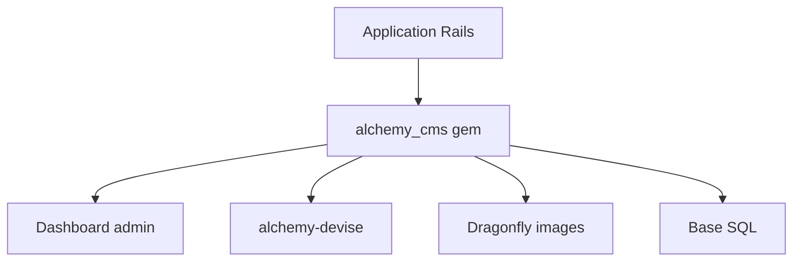

# AlchemyCMS/alchemy_cms

> Open source CMS engine in Ruby on Rails, for embedding a content back office.

## The problem
Rails sites need a multilingual content back office without starting from scratch.

## What it actually does
Adds to a Rails application an administration dashboard with templates separating content from layout, a REST API, page versions, multi-language and multi-domain support, access control, images resized on the fly (Dragonfly) and file attachments. Extended like a Rails engine.

## How it is wired
Simplified diagram based on the sheet, no diagram provided.


## Trying it
```bash
gem install rails
rails new -m https://raw.githubusercontent.com/AlchemyCMS/rails-templates/master/all.rb <MY-PROJECT-NAME>
bin/rails alchemy:install
bin/rake alchemy:upgrade
```

## Cost and gotchas
Free. Rails 7.2 or later, Ruby 3.1 or later (Ruby is not in the prerequisites list: real need), a SQL database and ImageMagick. On SQLite, some migrations delete data in cascade. The main branch is a development branch.

## What it is not
Not a data or AI tool. Not a no-code CMS: it integrates into Rails.

## Alternatives
No alternative named in the README.

## For you
Ignore: a Rails CMS unrelated to data / AI / MLOps work.
