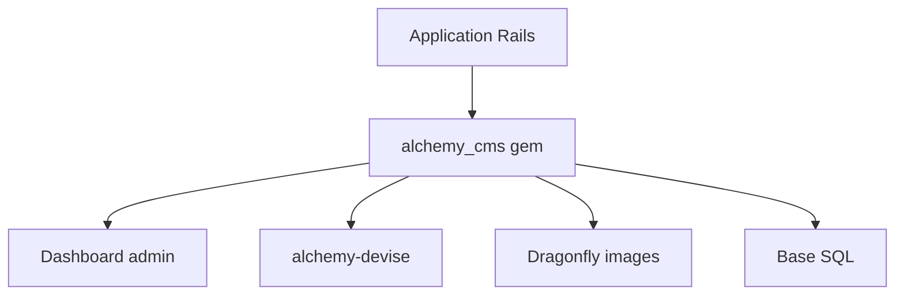

# AlchemyCMS/alchemy_cms

> Moteur de CMS open source en Ruby on Rails, pour intégrer un back-office de contenu.

## Le problème
Les sites Rails ont besoin d'un back-office de contenu multilingue sans repartir de zéro.

## Ce que ça fait vraiment
Ajoute à une application Rails un tableau de bord d'administration avec gabarits séparant contenu et mise en page, API REST, versions de pages, multi-langue et multi-domaine, contrôle d'accès, images redimensionnées à la volée (Dragonfly) et pièces jointes. S'étend comme un moteur Rails.

## Comment c'est branché
Schéma simplifié d'après la fiche, sans diagramme fourni.


## Essayer
```bash
gem install rails
rails new -m https://raw.githubusercontent.com/AlchemyCMS/rails-templates/master/all.rb <MY-PROJECT-NAME>
bin/rails alchemy:install
bin/rake alchemy:upgrade
```

## Coût et pièges
Gratuit. Rails 7.2 ou plus, Ruby 3.1 ou plus (Ruby n'est pas dans la liste des prérequis : besoin réel), une base SQL et ImageMagick. Sous SQLite, certaines migrations suppriment des données en cascade. La branche principale est une branche de développement.

## Ce que ce n'est pas
Pas un outil data ou IA. Pas un CMS sans code : il s'intègre à du Rails.

## Alternatives
Aucune alternative nommée dans le README.

## Pour toi
À ignorer : CMS Rails sans lien avec un travail data / IA / MLOps.

