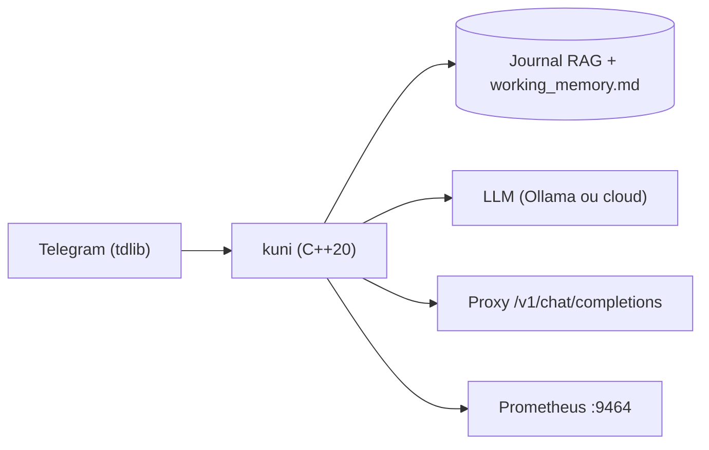

# Alex2772/kuni

> C++20 AI character that chats on Telegram with RAG memory and a nightly consolidation sleep.

## The problem
A language model forgets everything from one conversation to the next and does not behave like a person who remembers.

## What it actually does
A Telegram client (tdlib) gives the model the list of its chats, its unread messages and its replies. A vector journal (RAG) and a working memory (`data/working_memory.md`) keep the events; every night, a "sleep" phase merges, summarizes and removes redundant entries. An OpenAI-compatible proxy also serves as context enrichment for an IDE.

## How it is wired
Simplified diagram based on the sheet, no diagram provided.


## Trying it
```bash
docker compose up -d
cmake -G Ninja -B build -DCMAKE_BUILD_TYPE=RelWithDebInfo
cmake --build build
./build/bin/kuni
```

## Cost and gotchas
Recent C++20 compiler (GCC 15+, Clang 20+), Docker, a dedicated Telegram account, Telegram keys. A local model needs about 24 GB of VRAM; otherwise a cloud API (DeepSeek) is billed. No license: reuse rights are undefined.

## What it is not
Not an official bot: it is a userbot, forbidden by Telegram's terms, which the author acknowledges. Do not entrust it with sensitive information.

## Alternatives
No alternative named in the README.

## For you
Worth watching: the memory architecture (RAG, nightly consolidation) is instructive for an AI engineer, but without a license you cannot reuse the code.
