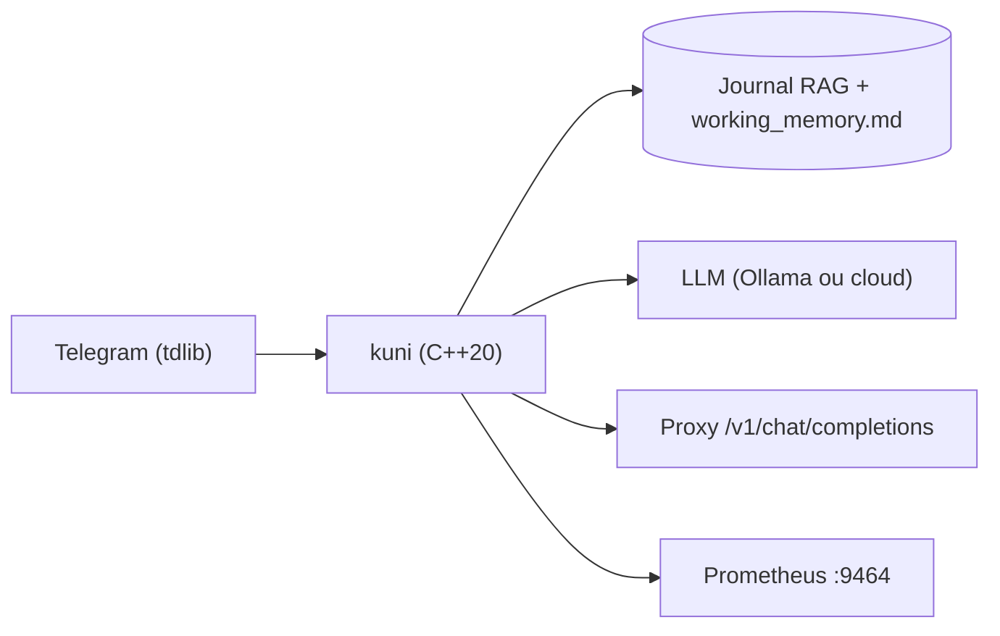

# Alex2772/kuni

> Personnage IA en C++20 qui discute sur Telegram avec mémoire RAG et sommeil nocturne de consolidation.

## Le problème
Un modèle de langage oublie tout d'une conversation à l'autre et ne se comporte pas comme une personne qui se souvient.

## Ce que ça fait vraiment
Un client Telegram (tdlib) donne au modèle la liste de ses chats, ses messages non lus et ses réponses. Un journal vectoriel (RAG) et une mémoire de travail (`data/working_memory.md`) conservent les événements ; chaque nuit, une phase de « sommeil » fusionne, résume et élimine les entrées redondantes. Un proxy compatible OpenAI sert aussi d'enrichissement de contexte pour un IDE.

## Comment c'est branché
Schéma simplifié d'après la fiche, sans diagramme fourni.


## Essayer
```bash
docker compose up -d
cmake -G Ninja -B build -DCMAKE_BUILD_TYPE=RelWithDebInfo
cmake --build build
./build/bin/kuni
```

## Coût et pièges
Compilateur C++20 récent (GCC 15+, Clang 20+), Docker, compte Telegram dédié, clés Telegram. Un modèle local demande environ 24 Go de VRAM ; sinon une API cloud (DeepSeek) est facturée. Aucune licence : droit de réutilisation non défini.

## Ce que ce n'est pas
Ce n'est pas un bot officiel : c'est un userbot, interdit par les conditions de Telegram, ce que l'auteur reconnaît. Il ne faut pas lui confier d'informations sensibles.

## Alternatives
Aucune alternative nommée dans le README.

## Pour toi
À surveiller : l'architecture mémoire (RAG, consolidation nocturne) est instructive pour un ingénieur IA, mais sans licence tu ne peux pas réutiliser le code.

