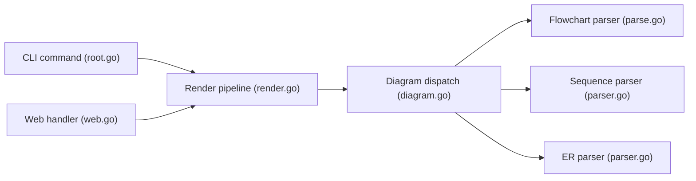

# AlexanderGrooff/mermaid-ascii

> Command-line tool that draws Mermaid diagrams as ASCII or Unicode art in the terminal.

## The problem
Viewing a Mermaid diagram without a browser or rendering engine, for example in a terminal or a plain-text README.

## What it actually does
- Renders flowcharts (`graph LR`/`TD`), sequence diagrams and entity-relationship diagrams.
- Spacing options, `--max-width`, pure ASCII mode, colors via `classDef`.
- Reads a file or standard input; optional web interface (`web`).
- Listed limits: no shapes other than rectangles, no diagonal arrows, no other diagram types.

## How it is wired


## Trying it
```bash
go build
mermaid-ascii --file test.mermaid
cat test.mermaid | mermaid-ascii --ascii
docker run -p 3001:3001 mermaid-ascii web --port 3001
```

## Cost and gotchas
Free, a single Go binary. Very dense diagrams may exceed the terminal width.

## What it is not
Not a replacement for Mermaid: a subset of the syntax.

## Alternatives
No alternative named in the README.

## For you
Adopt: a tiny tool with no dependencies, handy for displaying in a terminal or a log the diagrams your scripts or agents generate.
