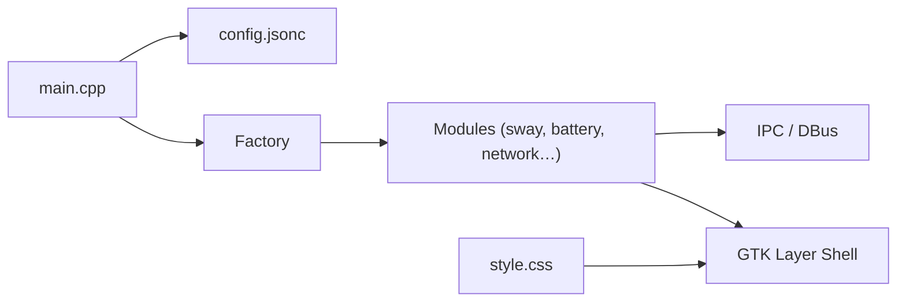

# Alexays/Waybar

> Highly configurable Wayland status bar for Sway and wlroots-based compositors.

## The problem
A tiling Wayland desktop has no bar: no workspaces, battery or network shown on screen.

## What it actually does
C++ application (gtkmm3, jsoncpp) that loads a config.jsonc, instantiates modules through a factory (Sway/Hyprland/River/Niri compositors, battery, CPU, network, audio, MPD, custom scripts) and displays them via GTK layer shell, styled with CSS. The modules listen to DBus or the compositors' IPC sockets.

## How it is wired


## Trying it
```bash
git clone https://github.com/Alexays/Waybar
cd Waybar
meson setup build
ninja -C build
./build/waybar
```

## Cost and gotchas
Free. Many build dependencies (gtkmm3, spdlog, wayland-protocols…); 753 open issues.

## What it is not
Works only under Wayland, not X11. It is not a window manager.

## Alternatives
No alternative named in the README.

## For you
Unrelated to data/AI work: useful only if you use Sway or Hyprland as your workstation.
