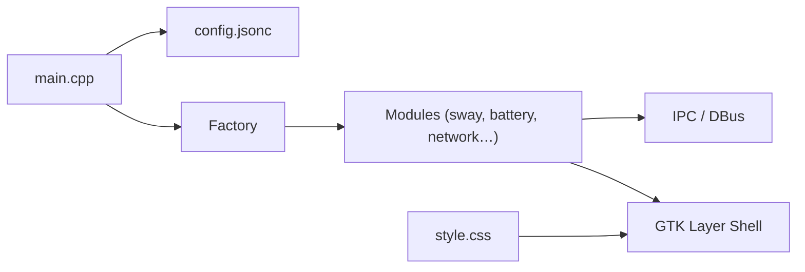

# Alexays/Waybar

> Barre de statut Wayland très configurable pour Sway et compositeurs basés sur wlroots.

## Le problème
Un bureau Wayland tiling n'a pas de barre : ni espaces de travail, ni batterie, ni réseau à l'écran.

## Ce que ça fait vraiment
Application C++ (gtkmm3, jsoncpp) qui charge un config.jsonc, instancie via une factory des modules (compositeurs Sway/Hyprland/River/Niri…, batterie, CPU, réseau, audio, MPD, scripts perso) et les affiche via GTK layer shell, stylés par CSS. Les modules écoutent DBus ou les sockets IPC des compositeurs.

## Comment c'est branché


## Essayer
```bash
git clone https://github.com/Alexays/Waybar
cd Waybar
meson setup build
ninja -C build
./build/waybar
```

## Coût et pièges
Gratuit. Beaucoup de dépendances de build (gtkmm3, spdlog, wayland-protocols…) ; 753 issues ouvertes.

## Ce que ce n'est pas
Ne fonctionne que sous Wayland, pas sous X11. Ce n'est pas un gestionnaire de fenêtres.

## Alternatives
Aucune alternative nommée dans le README.

## Pour toi
Sans rapport avec le travail data/IA : utile seulement si tu utilises Sway ou Hyprland comme poste de travail.

