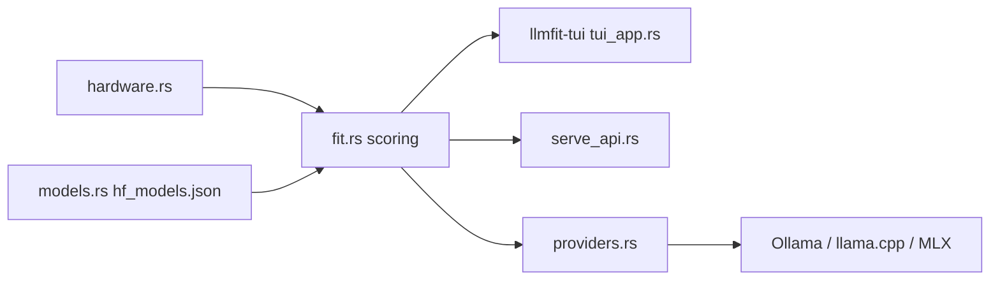

# AlexsJones/llmfit

> Detects your hardware and ranks the open source LLMs that run well on it.

## The problem
You download dozens of gigabytes of models only to find they don't fit in RAM/VRAM or are too slow.

## What it actually does
Detects CPU, RAM, GPU (CUDA, Apple Silicon, ROCm, OneAPI), then scores each model in an embedded catalog on four axes: memory fit, estimated speed, quality, context. TUI by default, CLI (`recommend`, `fit`, `info`, `bench`), HTTP server with a JSON API and a web dashboard. Plugs into Ollama, llama.cpp, MLX, LM Studio, Docker Model Runner. Speed estimates come from a memory bandwidth model.

## How it is wired


## Trying it
```bash
brew install AlexsJones/llmfit/llmfit
llmfit recommend --json
llmfit serve --host 0.0.0.0 --port 8787
```

## Cost and gotchas
Free. The model catalog is frozen at compile time and refreshed by the maintainers: a recent model may be missing. The community ranking queries an external service (localmaxxing.com) only if you use it.

## What it is not
Speeds are estimates, not measurements, unless you run `llmfit bench`. It does not download anything by itself without an explicit action.

## Alternatives
llm-checker: a Node tool that actually runs the models via Ollama, but treats MoE models as dense.

## For you
Worth adopting: a five-minute look avoids downloading models unsuited to your card; keep `llmfit bench` to validate the estimates.
