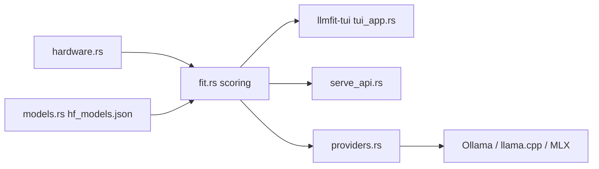

# AlexsJones/llmfit

> Détecte ton matériel et classe les LLM open source qui y tournent correctement.

## Le problème
On télécharge des dizaines de gigaoctets de modèles pour découvrir qu'ils ne tiennent pas en RAM/VRAM ou sont trop lents.

## Ce que ça fait vraiment
Détecte CPU, RAM, GPU (CUDA, Apple Silicon, ROCm, OneAPI), puis note chaque modèle d'un catalogue embarqué selon quatre axes : fit mémoire, vitesse estimée, qualité, contexte. TUI par défaut, CLI (`recommend`, `fit`, `info`, `bench`), serveur HTTP avec API JSON et tableau de bord web. Se branche sur Ollama, llama.cpp, MLX, LM Studio, Docker Model Runner. Les estimations de vitesse viennent d'un modèle de bande passante mémoire.

## Comment c'est branché


## Essayer
```bash
brew install AlexsJones/llmfit/llmfit
llmfit recommend --json
llmfit serve --host 0.0.0.0 --port 8787
```

## Coût et pièges
Gratuit. Le catalogue de modèles est figé à la compilation et rafraîchi par les mainteneurs : un modèle récent peut manquer. Le classement communautaire interroge un service externe (localmaxxing.com) seulement si tu l'utilises.

## Ce que ce n'est pas
Les vitesses sont des estimations, pas des mesures, sauf si tu lances `llmfit bench`. Il ne télécharge pas lui-même sans action explicite.

## Alternatives
llm-checker : outil Node qui exécute réellement les modèles via Ollama, mais traite les MoE comme denses.

## Pour toi
À adopter : un coup d'œil de cinq minutes évite de télécharger des modèles inadaptés à ta carte ; garde `llmfit bench` pour valider les estimations.

