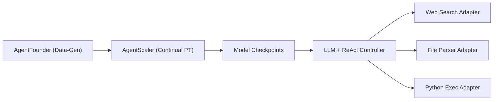

# Alibaba-NLP/DeepResearch

> Agentic model Tongyi DeepResearch 30B-A3B and inference scripts for long web research.

## The problem
Multi-step information-seeking tasks exhaust the context and reasoning of general-purpose LLMs.

## What it actually does
Publishes a 30.5B-parameter MoE model (3.3B active), 128K context, trained by continual pre-training on agentic data and on-policy RL.
Two inference modes: ReAct, and "Heavy" based on IterResearch to scale test-time compute.
The `run_react_infer.sh` script runs the model on a JSON/JSONL question set with tools: Serper search, Jina reading, file parsing, Python sandbox.
Also gathers a family of WebAgent prototypes and evaluation scripts.

## How it is wired


## Trying it
```bash
conda create -n react_infer_env python=3.10.0
conda activate react_infer_env
pip install -r requirements.txt
cp .env.example .env
bash run_react_infer.sh
```

## Cost and gotchas
Five external services to configure (Serper, Jina, OpenAI-compatible API, Dashscope, SandboxFusion). Local weights on GPU, or via OpenRouter without a GPU.

## What it is not
Not a ready-to-use application: it is a benchmark-oriented research kit. The online demo is unstable, the README states.

## Alternatives
No alternative named; the README lists its own work (WebDancer, WebSailor...).

## For you
Worth watching: an interesting open model for "deep research", but the dependence on several paid APIs makes experimenting more expensive than it looks.
