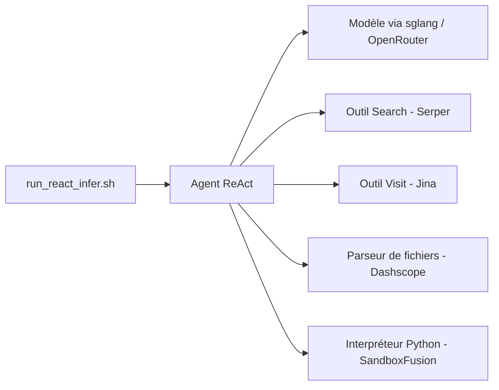

# Alibaba-NLP/WebAgent

> Code and model for Tongyi DeepResearch (30B, 3B active) for long-form information seeking on the web.

## The problem
General-purpose language models struggle with questions that require long chains of web searches.

## What it actually does
The repository hosts Tongyi DeepResearch, an agentic model with 30.5 billion parameters (3.3 billion active, 128K context), and the ReAct inference scripts or "Heavy" mode. The README claims state-of-the-art results on search benchmarks; take that as the author's claim. The code also contains WebDancer (Gradio demo, training) and WebWalker (benchmark with RAG). A long list of papers from the family is provided.

## How it is wired


## Trying it
```bash
conda create -n react_infer_env python=3.10.0
conda activate react_infer_env
pip install -r requirements.txt
cp .env.example .env
bash run_react_infer.sh
```

## Cost and gotchas
Several keys (Serper, Jina, Dashscope, summarization API) and a Python sandbox. Without a GPU, the model can be used via OpenRouter by modifying `react_agent.py`. Python 3.10.0 recommended.

## What it is not
Not a ready-to-use service: the online demo is reported as unstable. Last push on 2026-02-27, activity slowed down.

## Alternatives
No external alternative named; the cited papers (WebWalker, WebDancer, WebSailor…) are variants of the same family.

## For you
Worth watching: a useful reference for understanding a trained search agent, but getting started requires many third-party services.
