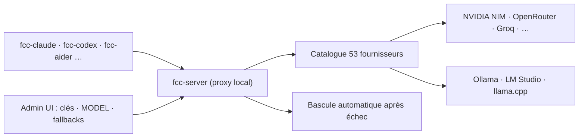

# Alishahryar1/free-claude-code

> A local proxy that connects ten code agents to 53 model providers.

## The problem
Each code agent is linked to its vendor; changing models or dealing with failures requires reconfiguring, or even starting over.

## What it actually does
A local server (`fcc-server`) with an administration UI, and agents for launching: `fcc-claude`, `fcc-codex`, `fcc-pi`, `fcc-opencode`, `fcc-cline`, `fcc-hermes`, `fcc-dsh`, `fcc-grok`, `fcc-muse`, `fcc-aider`. A single model catalog covers NVIDIA NIM, OpenRouter, Groq, xAI, Gemini, Vertex, Bedrock, Cerebras, Mistral, Z.ai, as well as LM Studio, llama.cpp, and Ollama locally. Automatic switching to the next model after retries are exhausted. Tiered routing (`MODEL_OPUS`, `MODEL_SONNET`, `MODEL_HAIKU`), reasoning level control, VS Code / JetBrains / Discord / Telegram integrations, and local Whisper or NVIDIA NIM voice notes.

## How it is wired


## Trying it
```bash
curl -fsSL "https://raw.githubusercontent.com/Alishahryar1/free-claude-code/main/scripts/install.sh" | sh
fcc-server
fcc-claude
```

## Cost and gotchas
Free quotas are set by each provider and may change. A failed request can consume quota at **multiple** providers before succeeding. The local proxy can be protected by a bearer token (an option to enable). Installation is performed using a remote script, which should be reviewed before execution.

## What it is not
An independent project, not affiliated with Anthropic, that specifies following the usage terms of the providers and removing integrations that would no longer be authorized. ChatGPT and Copilot subscriptions go through your account, not a key: organizational policies apply. The RTK integration is temporarily unavailable for OpenCode 2.

## Alternatives
No alternative is specified in the README file.

## For you
Important to note: This tool is useful for comparing models based on their interaction with a specific agent, but it is essential to review the terms and conditions of each provider before using it for professional purposes.
