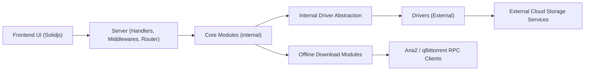

# AlistGo/alist

> Web file explorer written in Go that unifies many cloud and remote storages behind a single interface.

## The problem
Files are scattered across several cloud drives, each with its own interface and limits.

## What it actually does
A Go server (Gin) with a Solidjs interface. Each storage (local, S3, OneDrive, Google Drive, FTP/SFTP, WebDAV, SMB, Azure Blob, Aliyundrive, etc.) is a driver behind a common abstraction. It previews files, images, videos and documents, handles uploads, copying between storages, route protection and offline download (aria2, qBittorrent).

## How it is wired

The architecture text is a drawing guide, and several elements in it are assumed.

## Trying it
No command documented in the README (it points to the online guide at alistgo.com/guide).

## Cost and gotchas
Free, but each storage requires an account with the provider. The README warns: risk of account ban or rate limiting, at your own risk.

## What it is not
It is not a storage: it only redirects (302) or relays traffic to the providers. AGPL-3.0 license.

## Alternatives
No alternative named in the README.

## For you
Ignore: mostly aimed at consumer cloud drives, and the AGPL complicates any integration; for S3 or SFTP, the native tools are enough.
