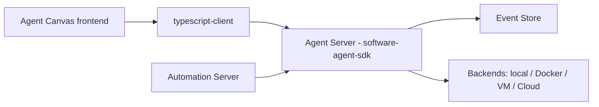

# All-Hands-AI/OpenHands

> Self-hosted development environment for launching and automating code agents (OpenHands, Claude Code, Codex, Gemini), designed for developers.

## The problem
The code agents each operate independently (on a terminal, VM, or in the cloud), and their coordination is poor. Automating recurring tasks (such as generating Slack reports or creating GitHub issues) requires a lot of manual effort.

## What it actually does
The README describes "Agent Canvas": an interface that initiates conversations with agents and connects to multiple "Agent Servers" (local, Docker, VM, OpenHands Cloud). An automation server triggers agents based on a schedule or a webhook (Slack, GitHub, Linear). The OpenHands agent is provided; any agent compatible with ACP can be connected. According to the code, the core Python functionality relies on a system of serialized events (actions/observations).

## How it is wired


## Trying it
```bash
npm install -g @openhands/agent-canvas
agent-canvas
```
```bash
docker run -it --rm \
  -p 8000:8000 \
  -v "$HOME/.openhands:/home/openhands/.openhands" \
  -v "${PROJECTS_PATH}:/projects" \
  ghcr.io/openhands/agent-canvas:1.20.0
```

## Cost and gotchas
Choose your preferred model: you are responsible for providing the supplier's API key. Without a sandbox, the agent has full access to your file system (as noted in the README). Node 22.12+ and `uv` are required.

## What it is not
Not a single agent: it's a dashboard that orchestrates agents. The deployment is divided into several components (SDK, TypeScript client, automation), and some functionalities are not included here. Security hardening for an exposed server is handled by SELF_HOSTING.md, which is not currently implemented.

## Alternatives
There is no named alternative mentioned in the README; Claude Code, Codex, and Gemini are agents that the tool controls, not competitors.

## For you
Things to watch out for: This can be useful if you want to manage multiple code agents for recurring tasks, but it requires accepting a multi-repository setup and a significant amount of sandboxing.
