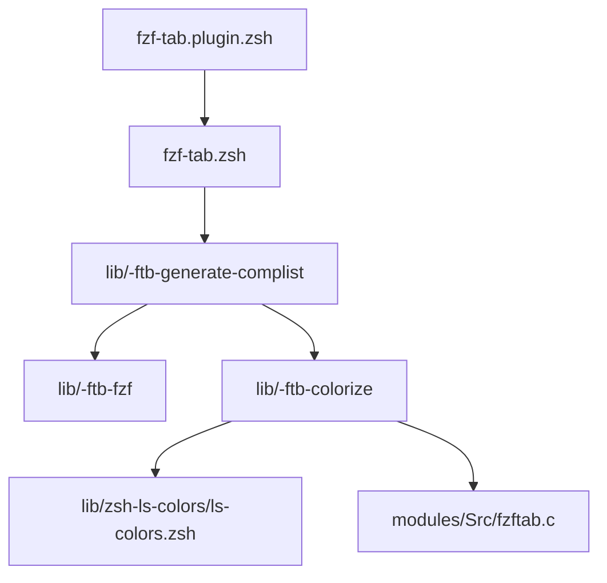

# Aloxaf/fzf-tab

> zsh plugin that replaces the completion menu with fzf, for terminal users.

## The problem
The native zsh completion menu is impractical for filtering long lists of files, options or variables.

## What it actually does
It takes the completion list from zsh and passes it to fzf, to filter with the keyboard, select several results, switch groups and preview (for example `eza` on `cd`). It does not complete by itself: it displays the result of the existing system. An optional binary module speeds up coloring.

## How it is wired


## Trying it
```bash
git clone https://github.com/Aloxaf/fzf-tab ~/somewhere
# dans ~/.zshrc :
# autoload -U compinit; compinit
# source ~/somewhere/fzf-tab.plugin.zsh
```

## Cost and gotchas
Free (MIT). fzf and zsh required; load after `compinit` but before plugins that wrap widgets. It must be the last to bind the Tab key; the last push dates from June 2026.

## What it is not
Not a completion engine: it provides no new rules. Does not work with bash.

## Alternatives
- lincheney/fzf-tab-completion: fzf completion for zsh, bash and readline applications.

## For you
Adopt if you spend a lot of time in a zsh terminal (servers, containers, repositories): immediate gain, one-line installation.
