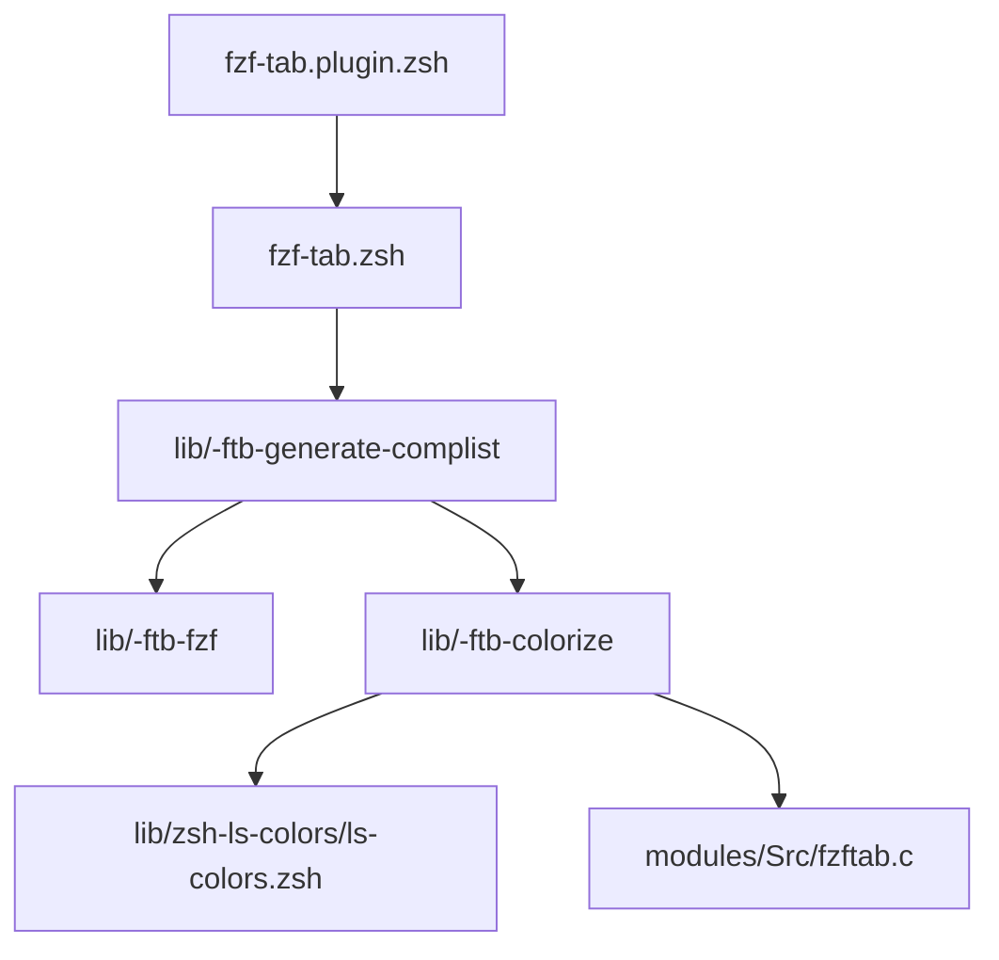

# Aloxaf/fzf-tab

> Plugin zsh qui remplace le menu de complétion par fzf, pour utilisateurs de terminal.

## Le problème
Le menu de complétion natif de zsh est peu pratique pour filtrer de longues listes de fichiers, options ou variables.

## Ce que ça fait vraiment
Il récupère la liste de complétions de zsh puis la passe à fzf, pour filtrer au clavier, sélectionner plusieurs résultats, changer de groupe et prévisualiser (par exemple `eza` sur `cd`). Il ne complète pas lui-même : il affiche le résultat du système existant. Un module binaire optionnel accélère la coloration.

## Comment c'est branché


## Essayer
```bash
git clone https://github.com/Aloxaf/fzf-tab ~/somewhere
# dans ~/.zshrc :
# autoload -U compinit; compinit
# source ~/somewhere/fzf-tab.plugin.zsh
```

## Coût et pièges
Gratuit (MIT). fzf et zsh requis ; charger après `compinit` mais avant les plugins qui enveloppent des widgets. Doit être le dernier à lier la touche Tab ; le dernier push date de juin 2026.

## Ce que ce n'est pas
Pas un moteur de complétion : il ne fournit aucune nouvelle règle. Ne fonctionne pas avec bash.

## Alternatives
- lincheney/fzf-tab-completion : complétion fzf pour zsh, bash et applications readline.

## Pour toi
À adopter si tu passes beaucoup de temps dans un terminal zsh (serveurs, conteneurs, dépôts) : gain immédiat, installation d'une ligne.

