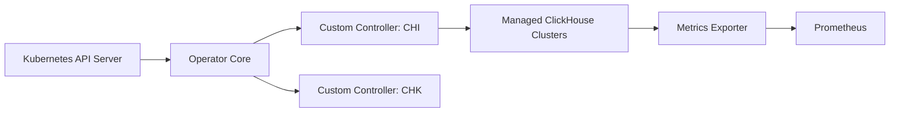

# Altinity/clickhouse-operator

> Kubernetes operator to create, configure and scale ClickHouse clusters.

## The problem
Deploying replicated ClickHouse on Kubernetes: volumes, configuration, users, upgrades and schema propagation are tedious by hand.

## What it actually does
Custom resources describe the cluster; the `chi` (ClickHouse installations) and `chk` (Keeper) controllers reconcile the state. Handles volume, pod and service templates, configuration and users, scaling with automatic schema propagation, version upgrades, Prometheus export. FIPS 140-3 compatible images.

## How it is wired

## Trying it
No command in the README; it points to a Quick Start Guide and the detailed installation.

## Cost and gotchas
Prerequisites: Kubernetes 1.25+, ClickHouse 21.11+ (older versions: operator 0.23.7 or lower). Persistent storage and ZooKeeper/Keeper depending on replication.

## What it is not
Not ClickHouse nor a managed service: only Kubernetes automation.

## Alternatives
No alternative named in the README.

## For you
Keep an eye on it: relevant if ClickHouse carries your analytics or features on Kubernetes; the maturity and activity (recent push) are reassuring.
