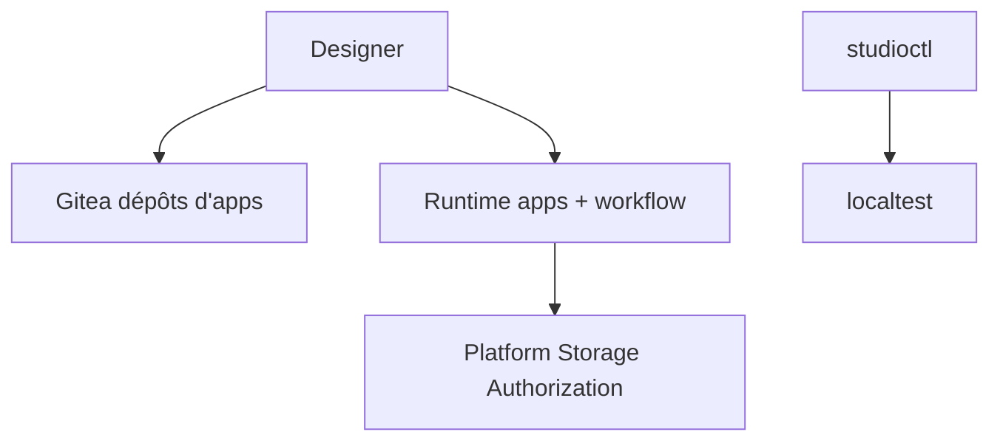

# Altinn/altinn-studio

> Norwegian platform where public administrations build, deploy and run digital services on Altinn 3.

## The problem
Norwegian public services must build forms and processes with signing and payment without starting from scratch.

## What it actually does
Three blocks: Core (Designer, assistant, Gitea repositories), Runtime (the applications, the workflow engine, gateway and operator at the service owner's site) and Platform (storage, authorization, receipt, pdf3, mostly in other repositories). Locally, `studioctl` launches localtest in place of Runtime and Platform.

## How it is wired
Simplified diagram based on the fiche, no diagram provided.

## Trying it
No command documented in the README; it points to docs.altinn.studio, CONTRIBUTING.md and the docs/ folder.

## Cost and gotchas
Free, but the repository is for developing Studio itself, not for building an application. Real deployment requires a cluster and the Altinn ecosystem.

## What it is not
Not a general-purpose forms tool: it is tied to Altinn 3 and the Norwegian administration. A large part of the Platform lives outside this repository.

## Alternatives
No alternative named in the README.

## For you
Ignore: platform specific to the Norwegian administration, no use for a data, AI or MLOps profile.
