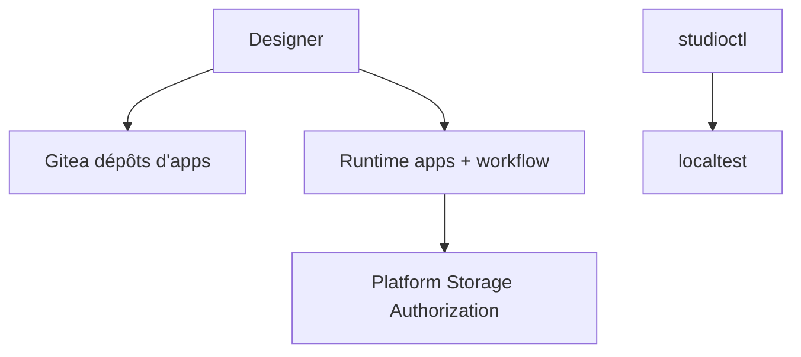

# Altinn/altinn-studio

> Plateforme norvégienne où les administrations construisent, déploient et font tourner des services numériques sur Altinn 3.

## Le problème
Les services publics norvégiens doivent bâtir des formulaires et des processus avec signature et paiement sans repartir de zéro.

## Ce que ça fait vraiment
Trois blocs : Core (Designer, assistant, dépôts Gitea), Runtime (les applications, le moteur de workflow, passerelle et opérateur chez le propriétaire du service) et Platform (stockage, autorisation, reçu, pdf3, surtout dans d'autres dépôts). En local, `studioctl` lance localtest à la place de Runtime et Platform.

## Comment c'est branché
Schéma simplifié d'après la fiche, sans diagramme fourni.

## Essayer
Aucune commande documentée dans le README ; il renvoie à docs.altinn.studio, CONTRIBUTING.md et au dossier docs/.

## Coût et pièges
Gratuit, mais le dépôt sert à développer Studio lui-même, pas à bâtir une application. Le déploiement réel suppose un cluster et l'écosystème Altinn.

## Ce que ce n'est pas
Pas un outil général de formulaires : il est lié à Altinn 3 et à l'administration norvégienne. Une grande partie de la Platform est hors de ce dépôt.

## Alternatives
Aucune alternative nommée dans le README.

## Pour toi
À ignorer : plateforme spécifique à l'administration norvégienne, sans usage pour un profil data, IA ou MLOps.

