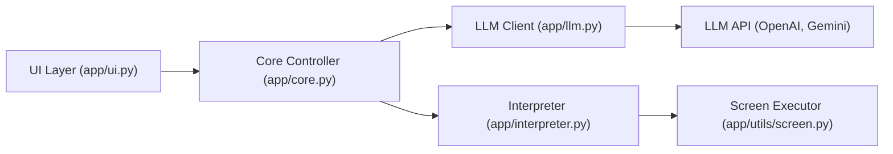

# AmberSahdev/Open-Interface

> Desktop application that drives your computer's keyboard and mouse through an LLM, based on screenshots.

## The problem
Automating graphical tasks without an API or script, simply by describing the goal.

## What it actually does
Loop: a screenshot plus the goal are sent to the LLM, instructions come back, they are executed by simulating keyboard/mouse, then a new screenshot is taken. Models: GPT-4o, Gemini or any OpenAI-compatible backend. Binaries for macOS, Linux (tested on Ubuntu 20.04) and Windows 10, or a Python 3.12+ script.

## How it is wired


## Trying it
```bash
git clone https://github.com/AmberSahdev/Open-Interface.git
cd Open-Interface
python -m venv .venv
source .venv/bin/activate
pip install -r requirements.txt
python app/app.py
```

## Cost and gotchas
An OpenAI key is required ($5 minimum for GPT-4o); $0.0005 to $0.002 per call, from two to several dozen calls per request. Accessibility and screen-recording permissions on Mac. Only sees the main screen.

## What it is not
Not reliable on spatial reasoning, spreadsheets or cursor-heavy applications (the README says so). It actually acts on your machine.

## Alternatives
No alternative named in the README.

## For you
Worth watching: an interesting demonstration of LLM computer control, but letting a model act on your machine is risky; try it in a VM.
