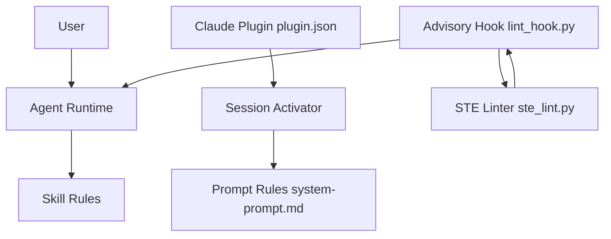

# AminBlg/SimpleEnglish

> An agent skill that forces LLMs to write in simple English, inspired by ASD-STE100.

## The problem
Agents produce answers full of bold text, long dashes and jargon. Generated docs are long and ambiguous.

## What it actually does
A skill (`SKILL.md`, about 1,700 tokens) enforces two registers: chat answers in plain prose, documents with sentences of at most 20 words. A Strict mode adds the STE vocabulary. A session hook activates the rules, and an advisory hook runs a linter on Markdown without blocking. The benchmarks come from Claude runs judged by Claude models; the author flags a possible bias and no run exists for version 2.1.0.

## How it is wired


## Trying it
```bash
npx skills add AminBlg/SimpleEnglish
claude plugin marketplace add AminBlg/SimpleEnglish && claude plugin install simple-english@simple-english
codex plugin marketplace add AminBlg/SimpleEnglish
codex plugin add simple-english@simple-english
```

## Cost and gotchas
Free. The hook requires Node.js. The skill alone installs neither the hook nor the output style: you need the plugin, and the full name `simple-english:simple-english`.

## What it is not
Not an STE certification: the README says nothing certifies it. No dictionary provided (the standard forbids it), you have to extract your own from the PDF. Flat English can sound robotic for editorial content.

## Alternatives
None named in the README.

## For you
Worth watching: useful if your agents write docs or READMEs in English, but the numerical evidence is self-judged and has no run on the current version.
