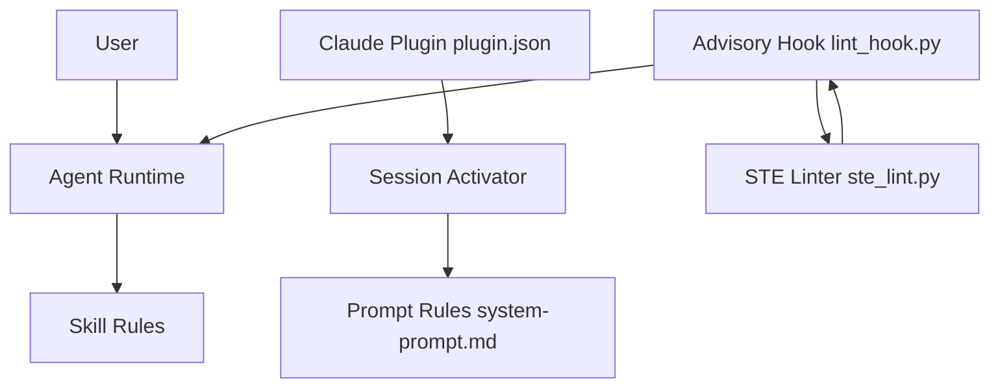

# AminBlg/SimpleEnglish

> Un skill d'agent qui force les LLM à écrire en anglais simple, inspiré de l'ASD-STE100.

## Le problème
Les agents produisent des réponses pleines de gras, de tirets longs et de jargon. Les docs générées sont longues et ambiguës.

## Ce que ça fait vraiment
Un skill (`SKILL.md`, environ 1 700 tokens) impose deux registres : réponses de chat en prose simple, documents avec phrases de 20 mots maximum. Un mode Strict ajoute le vocabulaire STE. Un hook de session active les règles, un hook consultatif lance un linter sur le Markdown sans bloquer. Les benchmarks viennent de runs Claude jugés par des modèles Claude ; l'auteur signale un biais possible et aucun run n'existe pour la version 2.1.0.

## Comment c'est branché


## Essayer
```bash
npx skills add AminBlg/SimpleEnglish
claude plugin marketplace add AminBlg/SimpleEnglish && claude plugin install simple-english@simple-english
codex plugin marketplace add AminBlg/SimpleEnglish
codex plugin add simple-english@simple-english
```

## Coût et pièges
Gratuit. Le hook exige Node.js. Le skill seul n'installe ni hook ni output style : il faut le plugin, et le nom complet `simple-english:simple-english`.

## Ce que ce n'est pas
Ni une certification STE : le README dit que rien ne certifie. Pas de dictionnaire fourni (la norme l'interdit), il faut extraire le sien du PDF. L'anglais plat peut sonner robotique pour du contenu éditorial.

## Alternatives
Aucune nommée dans le README.

## Pour toi
À surveiller : utile si tes agents rédigent des docs ou READMEs en anglais, mais les preuves chiffrées sont auto-jugées et sans run sur la version courante.

