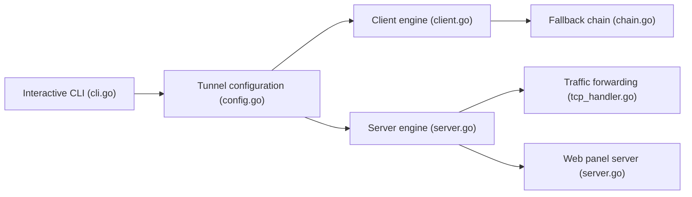

# AminMGMT/BackPack

> Go tunnel engine between Iranian and foreign servers, with a CLI, web panel and transport fallback.

## The problem
Network routes to Iran are filtered or unstable and a single protocol does not hold up.

## What it actually does
Reverse tunnel (the foreign server calls the Iranian server) or full IP tunnel over GRE encrypted with Noise. Twelve transports (TCP, Stealth, PCK, KCP+FEC, QUIC, WS/WSS, ICMP), automatic switchover, link test, Telegram monitoring, web panel on port 7777, backups, verified updates with rollback.

## How it is wired


## Trying it
```bash
bash <(curl -fsSL https://raw.githubusercontent.com/AminMGMT/BackPack/main/install.sh)
sudo backpack
```

## Cost and gotchas
Two servers needed, root for some transports. AGPL-3.0 license; the name and logo are not under license; attribution notice mandatory for forks.

## What it is not
Not a guaranteed privacy tool: the simple transports do not encrypt the token. July 2026 project, young.

## Alternatives
No alternative named in the README.

## For you
Ignore: network circumvention tool unrelated to data, AI or MLOps, and young.
