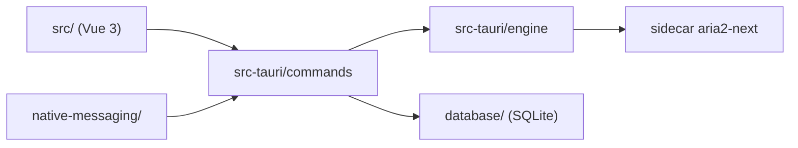

# AnInsomniacy/motrix-next

> Desktop download manager, now Rayburst, for downloading HTTP, torrents and HLS/DASH streams.

## The problem
Free download managers are dated or limited to a single protocol.

## What it actually does
Tauri 2 application (Vue 3 + Rust) built around an Aria2 Next engine. It handles HTTP/S, SFTP, ED2K, BitTorrent, magnet, HLS and DASH, with rate limits, scheduling, a browser extension and SQLite history. The README announces that the project is now called Rayburst and that settings are not imported.

## How it is wired


## Trying it
```bash
git clone https://github.com/AnInsomniacy/rayburst.git
cd rayburst
pnpm install
pnpm tauri dev
```

## Cost and gotchas
Free. macOS builds are not notarized (`xattr -dr com.apple.quarantine`), no portable version. Rust, Node 22+ and pnpm 11 to build.

## What it is not
It is no longer the active repository under this name: it points to Rayburst, and stable builds may keep the old name.

## Alternatives
No alternative named in the README.

## For you
Ignore for a data/AI profile: a download client unrelated to your work, and the project is changing its name.
