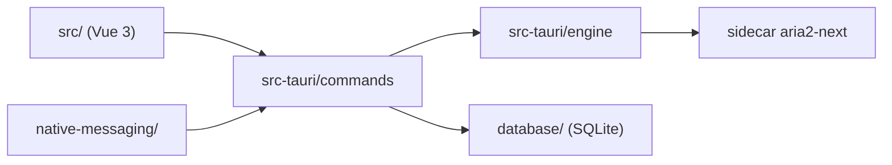

# AnInsomniacy/motrix-next

> Gestionnaire de téléchargements de bureau, devenu Rayburst, pour qui télécharge HTTP, torrents et flux HLS/DASH.

## Le problème
Les gestionnaires de téléchargement gratuits sont datés ou limités à un protocole.

## Ce que ça fait vraiment
Application Tauri 2 (Vue 3 + Rust) autour d'un moteur Aria2 Next. Elle gère HTTP/S, SFTP, ED2K, BitTorrent, magnet, HLS et DASH, avec limites de débit, planification, extension navigateur et historique SQLite. Le README annonce que le projet s'appelle désormais Rayburst et que les réglages ne sont pas importés.

## Comment c'est branché


## Essayer
```bash
git clone https://github.com/AnInsomniacy/rayburst.git
cd rayburst
pnpm install
pnpm tauri dev
```

## Coût et pièges
Gratuit. Builds macOS non notarisés (`xattr -dr com.apple.quarantine`), pas de version portable. Rust, Node 22+ et pnpm 11 pour compiler.

## Ce que ce n'est pas
Ce n'est plus le dépôt actif sous ce nom : il renvoie vers Rayburst, et les builds stables peuvent garder l'ancien nom.

## Alternatives
Aucune alternative nommée dans le README.

## Pour toi
À ignorer pour un profil data/IA : un client de téléchargement sans lien avec ton métier, et le projet change de nom.

