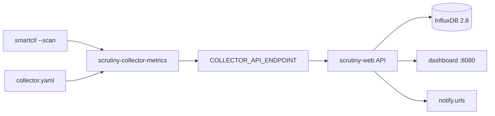

# AnalogJ/scrutiny

> Web dashboard for disk S.M.A.R.T metrics, with history and alerts.

## The problem
`smartd` does not distinguish critical attributes from informational ones, keeps no history, and its manufacturer thresholds often only trigger once the disk is dead.

## What it actually does
Automatically detects disks via `smartctl --scan` and shows a dashboard focused on critical metrics.
Records the history of S.M.A.R.T attributes to spot slow degradation, and tracks temperature.
Applies custom thresholds derived from real failure rates, instead of manufacturer thresholds.
Configurable notifications: custom script, email, webhooks, Discord, Gotify, ntfy, Slack, Teams, Telegram and a dozen others.

## How it is wired


## Trying it
```bash
docker run -p 8080:8080 -p 8086:8086 --restart unless-stopped \
  -v `pwd`/scrutiny:/opt/scrutiny/config \
  -v /run/udev:/run/udev:ro \
  --cap-add SYS_RAWIO \
  --device=/dev/sda \
  ghcr.io/analogj/scrutiny:latest-omnibus
docker exec scrutiny /opt/scrutiny/bin/scrutiny-collector-metrics run
```

## Cost and gotchas
Free. The container requires `--cap-add SYS_RAWIO`, read access to `/run/udev`, and one `--device` per disk — plus `SYS_ADMIN` for NVMe. The README discourages `latest-` tags and recommends pinning a version. The collector runs once a day by default.

## What it is not
Not finished: the README announces upfront that it is a work in progress, with rough edges. Not a replacement for `smartd`: it builds on it. Some RAID controllers do not pass SMART data through, and `--scan` may misdetect the device type — to be fixed in the config.

## Alternatives
`smartd` alone — described as the foundation Scrutiny builds on, not as a competitor.

## For you
Worth installing on a workstation with several disks: detecting a dying disk before losing a dataset is worth the twenty minutes of setup.
