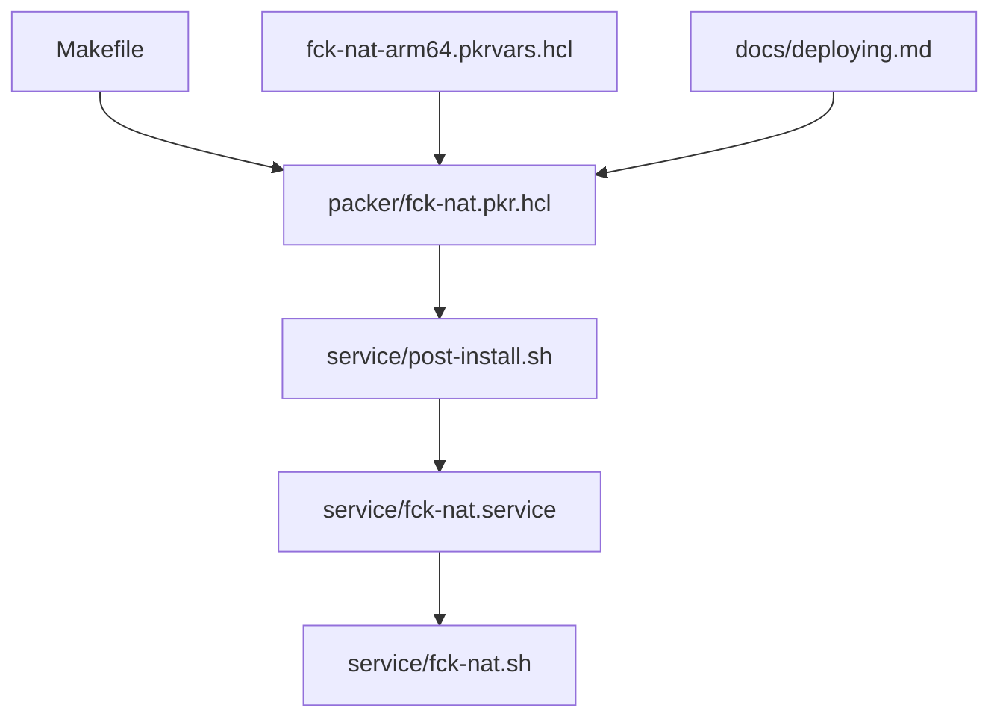

# AndrewGuenther/fck-nat

> Low-cost AWS NAT instance AMI, an alternative to managed NAT Gateways for cloud teams.

## The problem
AWS managed NAT Gateways are expensive per hour and per gigabyte, even when nearly idle.

## What it actually does
An ARM and x86 AMI on Amazon Linux 2023, built with Packer, which installs the fck-nat.service service running fck-nat.sh at boot. It sustains up to 5 Gbit/s in bursts on a t4g.nano. The README quotes $0.0042 per hour against $0.045 for a managed gateway, with no per-GB fees. A high-availability mode exists.

## How it is wired

## Trying it
No command documented in the README: deployment is described on fck-nat.dev.

## Cost and gotchas
An AWS account is required; instances and storage remain at your expense (about $0.64 per month on gp3). 5 Gbit/s cap set by AWS; no five-nines guarantee.

## What it is not
It is not a managed service: you run and update it. It is not suited to workloads above 5 Gbit/s.

## Alternatives
- AWS managed NAT Gateway: preferable beyond 5 Gbit/s or for maximum availability.
- Official AWS NAT AMI: not updated since 2018, based on Amazon Linux 1.

## For you
Adopt if your pipelines and GPUs run on AWS in private subnets: the savings are clear, provided you accept running the instance yourself.
