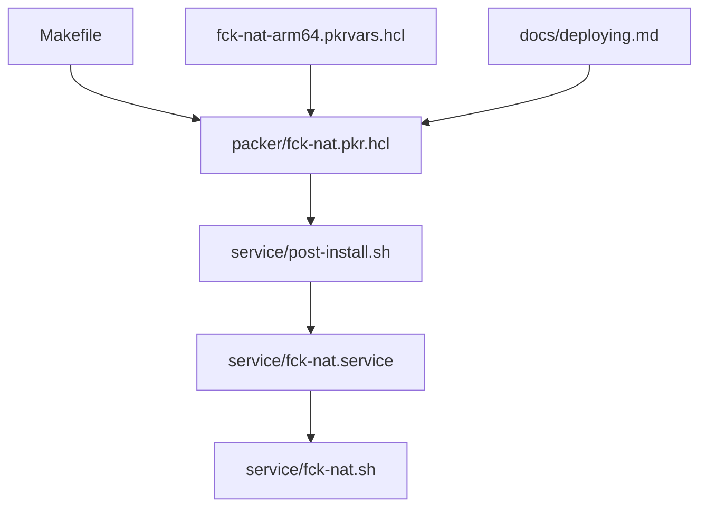

# AndrewGuenther/fck-nat

> AMI AWS d'instance NAT à bas coût, alternative aux NAT Gateways managées pour équipes cloud.

## Le problème
Les NAT Gateways managées d'AWS coûtent cher à l'heure et au gigaoctet, même presque inactives.

## Ce que ça fait vraiment
Une AMI ARM et x86 sur Amazon Linux 2023, construite avec Packer, qui installe le service fck-nat.service exécutant fck-nat.sh au démarrage. Elle tient jusqu'à 5 Gbit/s en rafale sur une t4g.nano. Le README chiffre 0,0042 $ l'heure contre 0,045 $ pour une passerelle managée, sans frais par Go. Un mode haute disponibilité existe.

## Comment c'est branché

## Essayer
Aucune commande documentée dans le README : le déploiement est décrit sur fck-nat.dev.

## Coût et pièges
Il faut un compte AWS ; les instances et le stockage restent à ta charge (environ 0,64 $ par mois en gp3). Plafond de 5 Gbit/s fixé par AWS ; pas de garantie de cinq neuf.

## Ce que ce n'est pas
Ce n'est pas un service managé : tu l'exploites et le mets à jour. Ce n'est pas adapté aux charges dépassant 5 Gbit/s.

## Alternatives
- NAT Gateway managée AWS : à préférer au-delà de 5 Gbit/s ou pour une disponibilité maximale.
- AMI NAT officielle AWS : plus mise à jour depuis 2018, basée sur Amazon Linux 1.

## Pour toi
À adopter si tes pipelines et tes GPU tournent sur AWS en sous-réseaux privés : l'économie est nette, à condition d'accepter d'exploiter l'instance.

