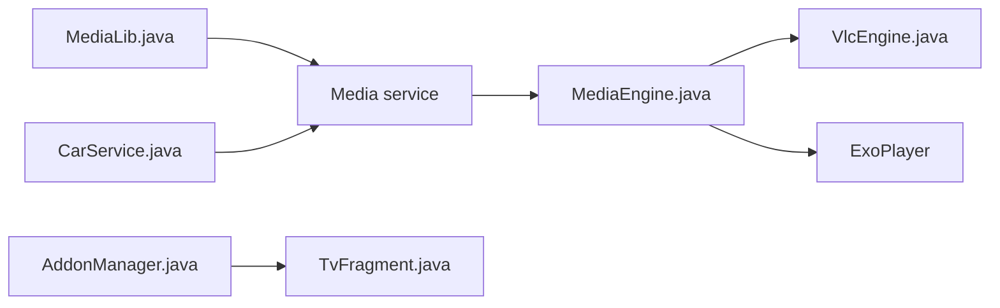

# AndreyPavlenko/Fermata

> Android audio, video and TV player, organized by folders and playlists, with interchangeable engines.

## The problem
Playing files organized by folders on Android, remembering the position, without a heavy interface.

## What it actually does
Folder-based playback, M3U/CUE playlists, favorites and bookmarks, equalizer and effects per track or folder, per-track speed, Android Auto and Android TV, IPTV addon (XMLTV EPG, catchup). Engines: MediaPlayer, ExoPlayer, VLC; subtitles and audio tracks only with VLC. The README warns against fraudulent sites imitating the app.

## How it is wired


## Trying it
```bash
git clone --recurse-submodules https://github.com/AndreyPavlenko/Fermata.git
cd Fermata
./gradlew bundleAutoRelease -PAPP_ID_SFX=.type.your.pkg.sfx.here
docker run -ti --name Fermata andreypavlenko/fermata
```

## Cost and gotchas
Free; donations requested. Build with the Android SDK or via Docker, a signing key is required.

## What it is not
Not a streaming player: the README mostly describes local files.

## Alternatives
No alternative named in the README.

## For you
Ignore: an Android media player unrelated to data/AI/MLOps.
