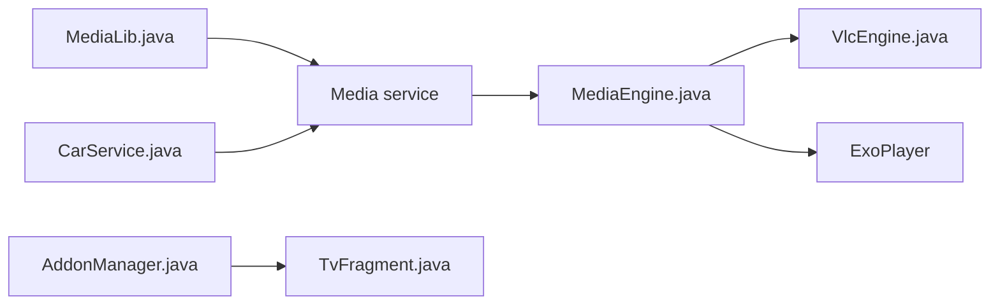

# AndreyPavlenko/Fermata

> Lecteur audio, vidéo et TV Android, organisé par dossiers et listes de lecture, avec moteurs interchangeables.

## Le problème
Lire des fichiers organisés par dossiers sur Android, en mémorisant la position, sans interface lourde.

## Ce que ça fait vraiment
Lecture par dossiers, listes M3U/CUE, favoris et signets, égaliseur et effets par piste ou dossier, vitesse par piste, Android Auto et Android TV, addon IPTV (XMLTV EPG, catchup). Moteurs : MediaPlayer, ExoPlayer, VLC ; sous-titres et pistes audio seulement avec VLC. Le README avertit contre des sites frauduleux imitant l'app.

## Comment c'est branché


## Essayer
```bash
git clone --recurse-submodules https://github.com/AndreyPavlenko/Fermata.git
cd Fermata
./gradlew bundleAutoRelease -PAPP_ID_SFX=.type.your.pkg.sfx.here
docker run -ti --name Fermata andreypavlenko/fermata
```

## Coût et pièges
Gratuit ; dons demandés. Compilation avec le SDK Android ou via Docker, clé de signature demandée.

## Ce que ce n'est pas
Pas un lecteur de streaming : le README décrit surtout des fichiers locaux.

## Alternatives
Aucune alternative nommée dans le README.

## Pour toi
À ignorer : lecteur multimédia Android sans lien avec data/IA/MLOps.

