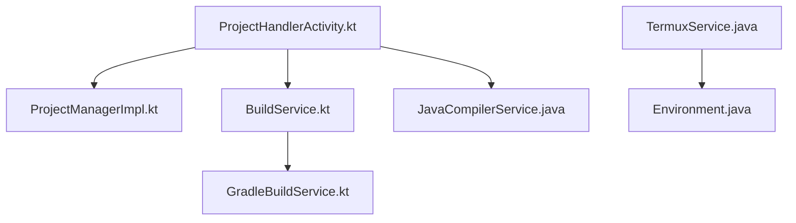

# AndroidCSOfficial/android-code-studio

> IDE installable on Android to develop Gradle-based Android applications, on the device.

## The problem
Developing an Android app assumes a computer; sometimes you want to code and build directly on the phone.

## What it actually does
An on-device IDE with Gradle, JDK 11 and 17, terminal, SDK and NDK management, Java, XML and Kotlin language servers, drag-and-drop interface editor, Git, log reader and an AI assistant that knows the project. The sampled code only confirms the project and build links; the rest is not detailed.

## How it is wired

## Trying it
No command: download the APK from GitHub Releases and follow the build tools installation guide.

## Cost and gotchas
Free. Projects on Android Gradle Plugin 7.2.0 or later. NDK cannot be installed through the SDK manager. Install only from trusted sources; unstable beta, 341 open issues.

## What it is not
Not a stable replacement for Android Studio: the author speaks of a beta. The keys or provider of the AI assistant are not documented.

## Alternatives
No alternative named in the README.

## For you
Ignore: a mobile Android IDE in beta, unrelated to data, AI or MLOps work.
