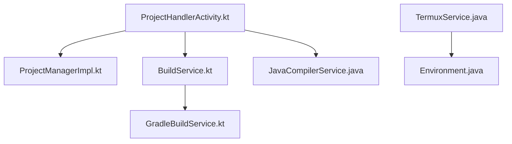

# AndroidCSOfficial/android-code-studio

> IDE installable sur Android pour développer des applications Android basées sur Gradle, sur l'appareil.

## Le problème
Développer une appli Android suppose un ordinateur ; on veut parfois coder et compiler directement sur le téléphone.

## Ce que ça fait vraiment
Un IDE sur appareil avec Gradle, JDK 11 et 17, terminal, gestion SDK et NDK, serveurs de langage Java, XML et Kotlin, éditeur d'interface par glisser-déposer, Git, lecteur de journaux et assistant IA qui connaît le projet. Le code échantillonné ne confirme que les liens projet et build ; le reste n'est pas détaillé.

## Comment c'est branché

## Essayer
Aucune commande : télécharger l'APK depuis GitHub Releases et suivre le guide d'installation des outils de build.

## Coût et pièges
Gratuit. Projets en Android Gradle Plugin 7.2.0 ou plus. NDK non installable via le gestionnaire SDK. Installer uniquement depuis les sources de confiance ; bêta instable, 341 issues ouvertes.

## Ce que ce n'est pas
Pas un remplaçant stable d'Android Studio : l'auteur parle de bêta. Les clés ou le fournisseur de l'assistant IA ne sont pas documentés.

## Alternatives
Aucune alternative nommée dans le README.

## Pour toi
Ignorer : un IDE Android mobile en bêta, sans lien avec un travail data, IA ou MLOps.

