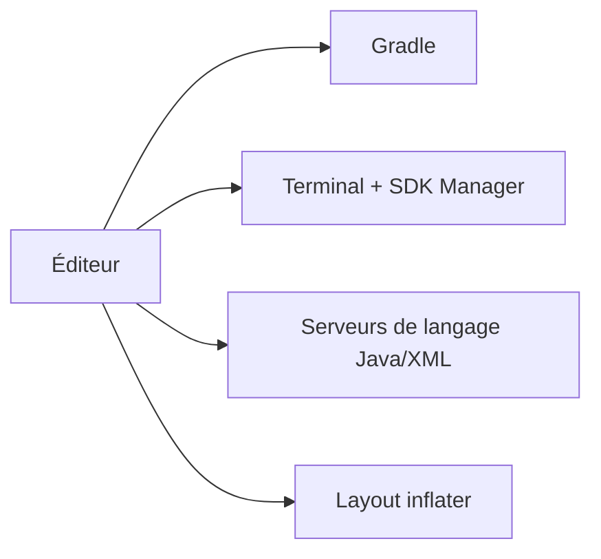

# AndroidIDEOfficial/AndroidIDE

> IDE that lets you develop Gradle Android applications directly on an Android device.

## The problem
Developing an Android application directly on a phone or tablet, without a PC: editing, Gradle builds and project management on the device itself.

## What it actually does
On-device editing and Gradle builds, JDK 11 and 17, terminal with packages, SDK Manager (through the terminal), log reader, Git, Java and XML language servers, visual layout editor. Projects need AGP 7.2.0 minimum; no official NDK. The README declares the project **unmaintained**.

## How it is wired

## Trying it
No command: install from F-Droid or the GitHub Releases, then install the build tools.

## Cost and gotchas
Free. Archived repository, 197 open issues, beta stage, no Kotlin or NDK.

## What it is not
Not a full Android Studio: no Kotlin language server, no Asset Studio.

## Alternatives
No alternative named in the README.

## For you
Ignore: archived and unmaintained, and unrelated to your data/AI profile.
