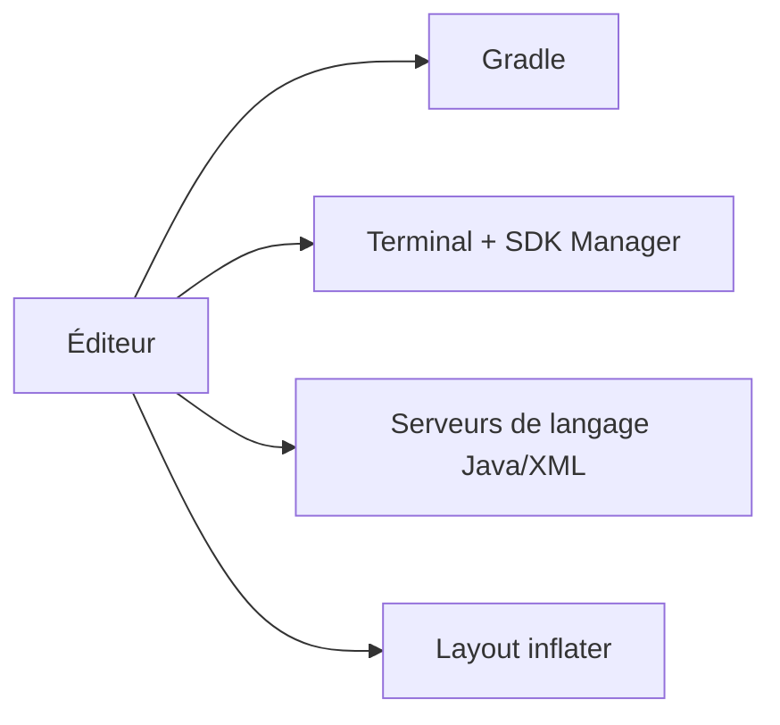

# AndroidIDEOfficial/AndroidIDE

> IDE qui permet de développer des applications Android Gradle directement sur un appareil Android.

## Le problème
Développer une application Android directement sur un téléphone ou une tablette, sans PC : édition, compilation Gradle et gestion du projet sur l'appareil lui-même.

## Ce que ça fait vraiment
Édition et build Gradle sur l'appareil, JDK 11 et 17, terminal avec paquets, SDK Manager (par le terminal), lecteur de logs, Git, serveurs de langage Java et XML, éditeur visuel de layouts. Projets AGP 7.2.0 minimum ; pas de NDK officiel. Le README déclare le projet **non maintenu**.

## Comment c'est branché

## Essayer
Aucune commande : installation depuis F-Droid ou les Releases GitHub, puis installer les outils de build.

## Coût et pièges
Gratuit. Dépôt archivé, 197 issues ouvertes, stade bêta, pas de Kotlin ni de NDK.

## Ce que ce n'est pas
Pas un Android Studio complet : pas de serveur de langage Kotlin, pas d'Asset Studio.

## Alternatives
Aucune alternative nommée dans le README.

## Pour toi
À ignorer : archivé et non maintenu, et sans rapport avec ton profil data/IA.

