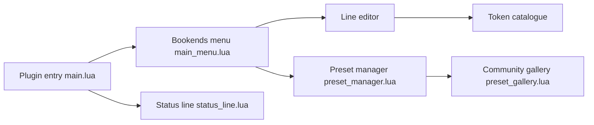

# AndyHazz/bookends.koplugin

> KOReader plugin that displays customizable text (pages, stats, bars, clock) on the reading screen.

## The problem
KOReader's native status bar is rigid and causes unnecessary screen refreshes.

## What it actually does
Six screen positions with token-based format lines (`%page_num`, `%book_pct`, `%bar`), `[if:…]` conditions, full-width progress bars, per-line styles. Savable presets with an online community gallery, automatic rules per file type (hide for CBZ, for example). Update from within KOReader.

## How it is wired


## Trying it
```bash
mkdir -p /mnt/us/koreader/plugins/bookends.koplugin/
```
Extract the zip of the latest release into KOReader's `plugins` folder, restart, then enable Bookends in the settings.

## Cost and gotchas
Free. The README advises disabling the native status bar. Time stats require KOReader's statistics plugin. The gallery uses an online submission service.

## What it is not
Not a standalone application: you need KOReader on the e-reader. Durations follow KOReader's format.

## Alternatives
Bookshelf (companion plugin, home screen for KOReader, cited in the README).

## For you
Ignore: e-reader display customization unrelated to data or AI.
