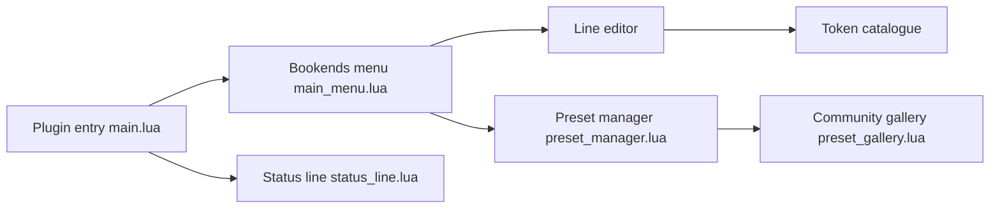

# AndyHazz/bookends.koplugin

> Greffon KOReader qui affiche des textes personnalisables (pages, stats, barres, horloge) sur l'écran de lecture.

## Le problème
La barre d'état native de KOReader est rigide et provoque des rafraîchissements d'écran inutiles.

## Ce que ça fait vraiment
Six positions d'écran avec des lignes de format à base de jetons (`%page_num`, `%book_pct`, `%bar`), conditions `[if:…]`, barres de progression pleine largeur, styles par ligne. Presets sauvegardables avec une galerie communautaire en ligne, règles automatiques par type de fichier (masquer pour CBZ par exemple). Mise à jour depuis KOReader.

## Comment c'est branché


## Essayer
```bash
mkdir -p /mnt/us/koreader/plugins/bookends.koplugin/
```
Extraire le zip de la dernière release dans le dossier `plugins` de KOReader, redémarrer, puis activer Bookends dans les réglages.

## Coût et pièges
Gratuit. Le README conseille de désactiver la barre d'état native. Les stats de temps nécessitent le greffon de statistiques de KOReader. La galerie utilise un service de soumission en ligne.

## Ce que ce n'est pas
Pas une application autonome : il faut KOReader sur la liseuse. Les durées suivent le format de KOReader.

## Alternatives
Bookshelf (greffon compagnon, écran d'accueil pour KOReader, cité dans le README).

## Pour toi
À ignorer : personnalisation d'affichage de liseuse sans lien avec la data ou l'IA.

