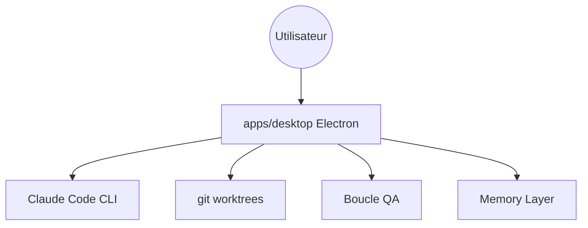

# AndyMik90/Auto-Claude

> Desktop application that orchestrates Claude agents to plan, code and validate software in parallel.

## The problem
Driving a coding agent by hand, task by task, without isolation or a validation loop, is slow and risky for the main branch.

## What it actually does
Electron application: you describe a goal, agents plan, implement and validate in isolated git worktrees, up to 12 terminals in parallel. QA loop, AI-assisted merging, memory across sessions, GitHub, GitLab and Linear integrations, kanban board. The repository is in maintenance mode (2.x): development of version 3.0 happens elsewhere and pull requests are suspended.

## How it is wired


## Trying it
```bash
npm install -g @anthropic-ai/claude-code
npm run install:all
npm start
```

## Cost and gotchas
Requires a Claude Pro/Max subscription, the Claude Code CLI and a git repository. Authentication through OAuth. The builds are 2.x maintenance versions.

## What it is not
Not independent of Claude: it depends on it. The current code is frozen in maintenance, and the apparent activity of the repository is low (last push in June 2026). AGPL license.

## Alternatives
No alternative named in the README.

## For you
Worth watching: interesting for multi-agent orchestration, but frozen at 2.x, single-maintainer and tied to a Claude subscription.
