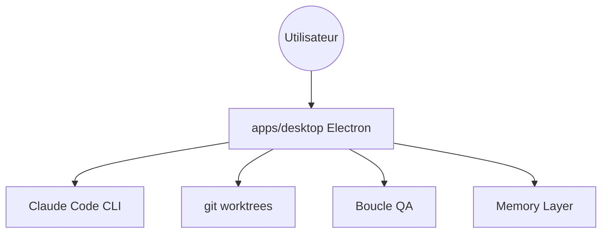

# AndyMik90/Auto-Claude

> Application bureau qui orchestre des agents Claude pour planifier, coder et valider du logiciel en parallèle.

## Le problème
Piloter un agent de code à la main, tâche par tâche, sans isolation ni boucle de validation, est lent et risqué pour la branche principale.

## Ce que ça fait vraiment
Application Electron : tu décris un objectif, des agents planifient, implémentent et valident dans des worktrees git isolés, jusqu'à 12 terminaux en parallèle. Boucle de QA, fusion assistée par IA, mémoire entre sessions, intégrations GitHub, GitLab et Linear, tableau kanban. Le dépôt est en mode maintenance (2.x) : le développement de la version 3.0 se fait ailleurs et les pull requests sont suspendues.

## Comment c'est branché


## Essayer
```bash
npm install -g @anthropic-ai/claude-code
npm run install:all
npm start
```

## Coût et pièges
Exige un abonnement Claude Pro/Max, le CLI Claude Code et un dépôt git. Authentification par OAuth. Les builds sont des versions de maintenance 2.x.

## Ce que ce n'est pas
Pas indépendant de Claude : il en dépend. Le code actuel est gelé en maintenance, et l'activité apparente du dépôt est faible (dernier push en juin 2026). Licence AGPL.

## Alternatives
Aucune alternative nommée dans le README.

## Pour toi
À surveiller : intéressant pour l'orchestration multi-agents, mais gelé en 2.x, mono-mainteneur et lié à un abonnement Claude.

