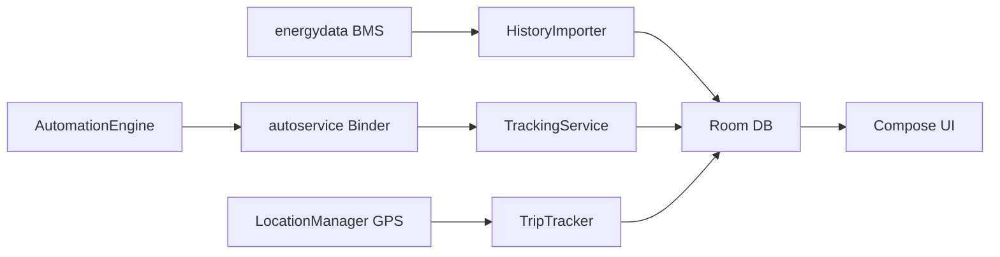

# AndyShaman/BYDMate

> Android app for the BYD DiLink screen: trip log, energy analytics, automations and a voice assistant.

## The problem
The BYD on-board computer underestimates consumption by 10 to 30% and exposes neither idle consumption, nor cell balance, nor trip costs.

## What it actually does
Reads consumption from the `energydata` BMS database and settings via the car's system service (wireless ADB required). Records GPS trips and AC/DC charges, computes costs by tariff period and shows a floating widget. Adds WHEN→THEN rules, projection onto the instrument cluster, the HUD (Yandex Navigator), blind-spot cameras, ABRP telemetry and a Russian voice agent with offline recognition and 32 tools.

## How it is wired


## Trying it
```bash
# Installer l'APK depuis Releases (clé USB ou adb) :
adb install BYDMate.apk
# Compiler (JDK 17, Android SDK 34) :
git clone https://github.com/AndyShaman/BYDMate.git
cd BYDMate
./gradlew assembleDebug
```

## Cost and gotchas
ADB must be enabled on the car: on DiLink 5.0 it is locked and the README points to TaoBao vendors (~40 to 80 ¥). The voice agent requires an LLM key (OpenRouter paid, or z.ai free but slower). Cloud features are disabled by default. The license is PolyForm Noncommercial 1.0.0.

## What it is not
Not a general-purpose tool: tested on the Leopard 3, the rest varies by model. Commands go through an ADB shell on the vehicle, so there is a risk to take seriously. Hybrids are supported since version 4.0.0, only partially.

## Alternatives
No alternative named in the README (inspired by BYD Trip Info by jayb).

## For you
Ignore: an in-car app tied to a car model and ADB access, out of reach of a data, AI or MLOps profile; the non-commercial license also restricts reuse.
