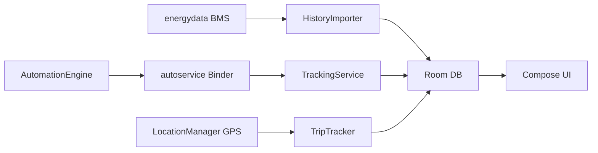

# AndyShaman/BYDMate

> Application Android pour l'écran DiLink des BYD : journal de trajets, analyses d'énergie, automatisations et assistant vocal.

## Le problème
L'ordinateur de bord BYD sous-estime la consommation de 10 à 30 % et n'expose ni consommation à l'arrêt, ni équilibre des cellules, ni coût des trajets.

## Ce que ça fait vraiment
Lit la consommation dans la base BMS `energydata` et les paramètres via le service système de la voiture (ADB sans fil requis). Enregistre trajets GPS et recharges AC/DC, calcule les coûts par périodes tarifaires et affiche un widget flottant. Ajoute des règles QUAND→ALORS, la projection sur le combiné, le HUD (Yandex Navigator), les caméras d'angle mort, la télémétrie ABRP et un agent vocal russe avec reconnaissance hors ligne et 32 outils.

## Comment c'est branché


## Essayer
```bash
# Installer l'APK depuis Releases (clé USB ou adb) :
adb install BYDMate.apk
# Compiler (JDK 17, Android SDK 34) :
git clone https://github.com/AndyShaman/BYDMate.git
cd BYDMate
./gradlew assembleDebug
```

## Coût et pièges
Il faut activer ADB sur la voiture : sur DiLink 5.0 il est verrouillé et le README renvoie à des vendeurs TaoBao (~40 à 80 ¥). L'agent vocal requiert une clé LLM (OpenRouter payant, ou z.ai gratuit mais plus lent). Fonctions cloud désactivées par défaut. La licence est PolyForm Noncommercial 1.0.0.

## Ce que ce n'est pas
Pas un outil généraliste : testé sur Leopard 3, le reste varie selon le modèle. Les commandes passent par un shell ADB sur le véhicule, donc un risque à prendre au sérieux. Les hybrides sont pris en charge depuis la version 4.0.0, de façon partielle.

## Alternatives
Aucune alternative nommée dans le README (inspirée de BYD Trip Info de jayb).

## Pour toi
À ignorer : application de bord liée à un modèle de voiture et à un accès ADB, hors de portée d'un profil data, IA ou MLOps ; la licence non commerciale restreint aussi la réutilisation.

