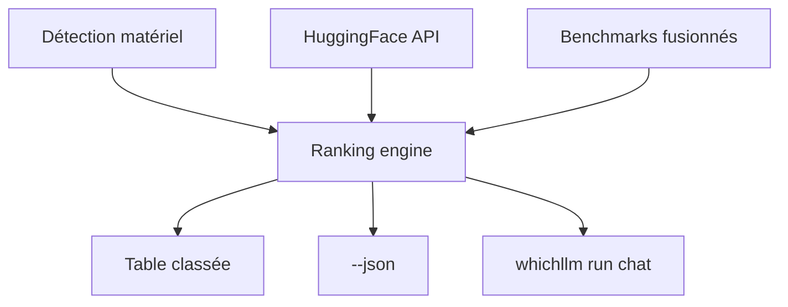

# Andyyyy64/whichllm

> CLI that detects your hardware and ranks the best local LLMs that run on it.

## The problem
Knowing which model *fits* in your VRAM is easy; knowing which of the models that fit is actually the best is not. "What fits" tools give you the biggest, not the best.

## What it actually does
Detects GPU/CPU/RAM (NVIDIA, AMD, Intel, Apple), ranks HuggingFace models by VRAM fit, speed and benchmark quality. The ranking is based on merged real benchmarks (LiveBench, Artificial Analysis, Aider, Arena ELO), not a size heuristic. Simulates a GPU (`--gpu "RTX 4090"`), plans a purchase, launches a chat (`whichllm run`), prints a Python snippet, outputs JSON. VRAM estimate = weights + KV cache + activation + overhead; speed is bandwidth-bound.

## How it is wired


## Trying it
```bash
uvx whichllm@latest
```
```bash
uvx whichllm@latest --gpu-only --speed usable --vram-headroom 1GB
```

## Cost and gotchas
Free, no key. Python 3.11+. Live data from HuggingFace (6h/24h cache) with offline fallback. Speeds are planning ranges, not live benchmarks. Single maintainer.

## What it is not
Not an inference engine: it recommends and can launch a chat via llama.cpp/transformers, but does not serve. The HF→Ollama mapping is up to you.

## Alternatives
- LM Studio: compared as the "comfortable" recommendation reference.
- Ollama: integration offered, not a substitute for ranking.

## For you
Excellent for a data scientist choosing a local LLM according to their machine; scriptable via JSON — adopt.
