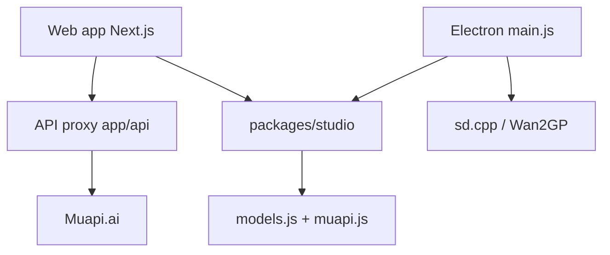

# Anil-matcha/Open-Generative-AI

> Image, video and lip sync generation studio, connected to the Muapi API or to local engines.

## The problem
Using several image and video generation models from a single interface, without a subscription to each platform.

## What it actually does
Web interface (Next.js) and desktop application (Electron) offering studios: image, video, audio, lip sync, cinema, workflows, agents. Most models go through the Muapi.ai API, with a key stored in the browser. Two local engines exist in the desktop app: sd.cpp (image, built in) and Wan2GP (your own server, CUDA/ROCm GPU). History and reference images are kept locally.

## How it is wired


## Trying it
```bash
git clone --recurse-submodules https://github.com/Anil-matcha/Open-Generative-AI.git
cd Open-Generative-AI
npm run setup
npm run electron:dev   # application de bureau
npm run dev            # version web → http://localhost:3000
```

## Cost and gotchas
The code is free, but generation via Muapi consumes an API key at your expense. The README also promotes a paid white-label offer (from $49/month). Unsigned installers (macOS and Windows warnings). The README states there are no content filters: responsibility for usage and legal compliance (rights, image rights, deepfakes) falls on you.

## What it is not
Not self-contained: "open source" does not prevent dependence on a third-party service for most models. Local inference covers only a few models, and the local video studio is not wired up yet. Data stays "local" only on that path.

## Alternatives
- Wan2GP: local server for video models, used here as a remote engine.
- stable-diffusion.cpp: image inference engine without going through a service.

## For you
Worth watching: useful for testing several generative models, but it is mostly a showcase for a paid SaaS; for local use, go to Wan2GP directly.
