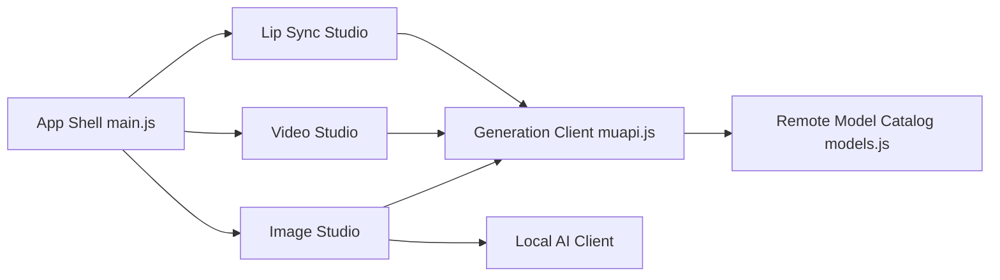

# Anil-matcha/Open-Higgsfield-AI

> Web and desktop interface for generating images, videos and lip sync through the paid Muapi.ai API.

## The problem
Video/image generation platforms are closed, subscription-based and filter prompts. Comparing several models requires as many accounts.

## What it actually does
- Groups "studios" (image, video, audio, lip sync, cinema, workflows, agents) in a single Next.js/React interface.
- Sends generations to the Muapi.ai API (submission then polling for the result) with a key entered in the browser.
- Optionally offers, in the Electron desktop app, local inference: sd.cpp (images) or a Wan2GP server of your own (video, large image models).
- Catalog of 400+ models defined in `models.js`; history stays in the browser's local storage.

## How it is wired


## Trying it
```bash
git clone --recurse-submodules https://github.com/Anil-matcha/Open-Generative-AI.git
cd Open-Generative-AI
npm run setup
npm run electron:dev   # app desktop
npm run dev            # version web → http://localhost:3000
```

## Cost and gotchas
A Muapi.ai key is required for remote models, billed per use; local mode needs 16 GB of RAM for Z-Image and a CUDA/ROCm GPU on the Wan2GP server side. Unsigned installers (Gatekeeper, SmartScreen) and git submodules to clone.

## What it is not
Not a standalone generation engine: most of it goes through a third-party SaaS. The claimed "no filter" does not exempt you from complying with the law or the model providers' terms. The README also mixes in a commercial white-label offer (from $49/month).

## Alternatives
- Wan2GP: local video/image generation server that the app can already drive, without going through a SaaS.
- stable-diffusion.cpp: local image engine, already embedded in the app.

## For you
Worth watching: useful for comparing generative models behind a single UI, but dependent on a paid third-party API and a single maintainer, so not a building block to industrialize.
