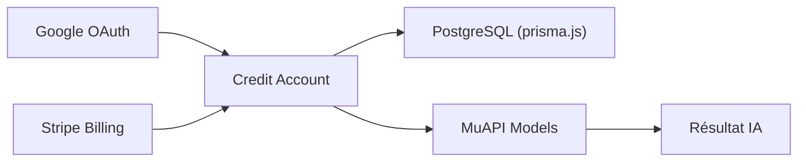

# Anil-matcha/awesome-generative-ai-apps

> Catalog of generative AI SaaS templates to clone, all wired to the paid MuAPI API.

## The problem
Launching a generative AI product requires writing auth, billing and async task management.

## What it actually does
Lists dozens of templates (images, video, writing, agents, voice) in separate repositories, all on Next.js, Prisma, PostgreSQL, Google OAuth and Stripe, with calls to MuAPI. It is not a single application. The text is promotional: revenue and margin figures without sources.

## How it is wired


## Trying it
```bash
git clone https://github.com/SamurAIGPT/<template-name>
cd <template-name>
cp .env.example .env
npx prisma db push && npm run dev
```

## Cost and gotchas
Variables to provide: DATABASE_URL, NEXTAUTH_SECRET, Google keys, Stripe, MUAPI_API_KEY. Each generation is billed by MuAPI.

## What it is not
No guaranteed revenue, despite the README's tone. No code here: most of it is in other repositories, not read.

## Alternatives
None cited outside the templates themselves (ai-saas-starter for the base without AI).

## For you
A commercial list tied to a single API provider: ignore.
