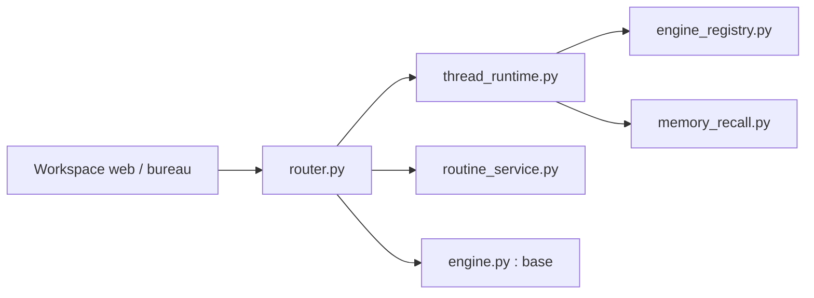

# Anil-matcha/open-duet

> Open workspace for creating named AI agents that delegate and run as routines.

## The problem
Driving several agents (Claude Code, Codex...) by hand loses context, tracking and control over actions.

## What it actually does
Creates agents with instructions, model, workspace, memory and approval mode (Ask first, Accept edits, Plan only). A lead agent delegates to specialists; routines run on a schedule or webhook; a task board and a calendar track the work. Engines: Claude Code, Codex CLI, Gemini CLI, Cursor, ACP, OpenRouter or an OpenAI-compatible API (Ollama, LM Studio). No model included.

## How it is wired


## Trying it
```bash
git clone https://github.com/Anil-matcha/open-duet.git
cd open-duet/desktop
npm run app
```

## Cost and gotchas
Node.js 22+, uv and an already-installed engine. Model costs are on you; the engine receives prompts and context. Unsigned installers, server for a single owner, experimental Docker computers and browser.

## What it is not
Not a multi-user workspace. No catalog of integrations (Gmail, Slack, Notion) for now. Auto-update is not verified end to end.

## Alternatives
No alternative named in the README.

## For you
Keep an eye on it: agent orchestration and routines interest an AI profile, but the project is experimental and has a single maintainer.
