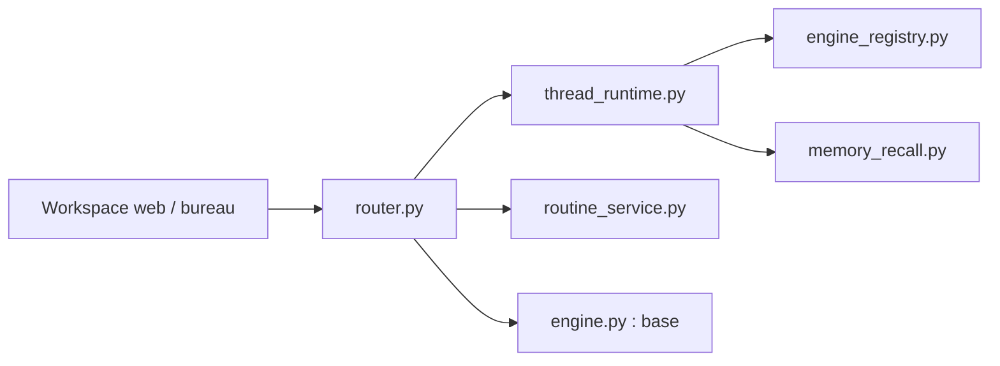

# Anil-matcha/open-duet

> Espace de travail libre pour créer des agents IA nommés, qui délèguent et tournent en routines.

## Le problème
Piloter plusieurs agents (Claude Code, Codex…) à la main fait perdre contexte, suivi et contrôle des actions.

## Ce que ça fait vraiment
Crée des agents avec instructions, modèle, espace de travail, mémoire et mode d'approbation (Ask first, Accept edits, Plan only). Un agent chef délègue à des spécialistes ; des routines tournent sur planning ou webhook ; un tableau de tâches et un calendrier suivent le travail. Moteurs : Claude Code, Codex CLI, Gemini CLI, Cursor, ACP, OpenRouter ou API compatible OpenAI (Ollama, LM Studio). Pas de modèle inclus.

## Comment c'est branché


## Essayer
```bash
git clone https://github.com/Anil-matcha/open-duet.git
cd open-duet/desktop
npm run app
```

## Coût et pièges
Node.js 22+, uv et un moteur déjà installé. Coût des modèles à ta charge ; le moteur reçoit prompts et contexte. Installeurs non signés, serveur pour un seul propriétaire, computers Docker et navigateur expérimentaux.

## Ce que ce n'est pas
Pas un espace multi-utilisateurs. Pas de catalogue d'intégrations (Gmail, Slack, Notion) pour l'instant. La mise à jour automatique n'est pas vérifiée de bout en bout.

## Alternatives
Aucune alternative nommée dans le README.

## Pour toi
À surveiller : l'orchestration d'agents et les routines intéressent un profil IA, mais le projet est expérimental et à mainteneur unique.

