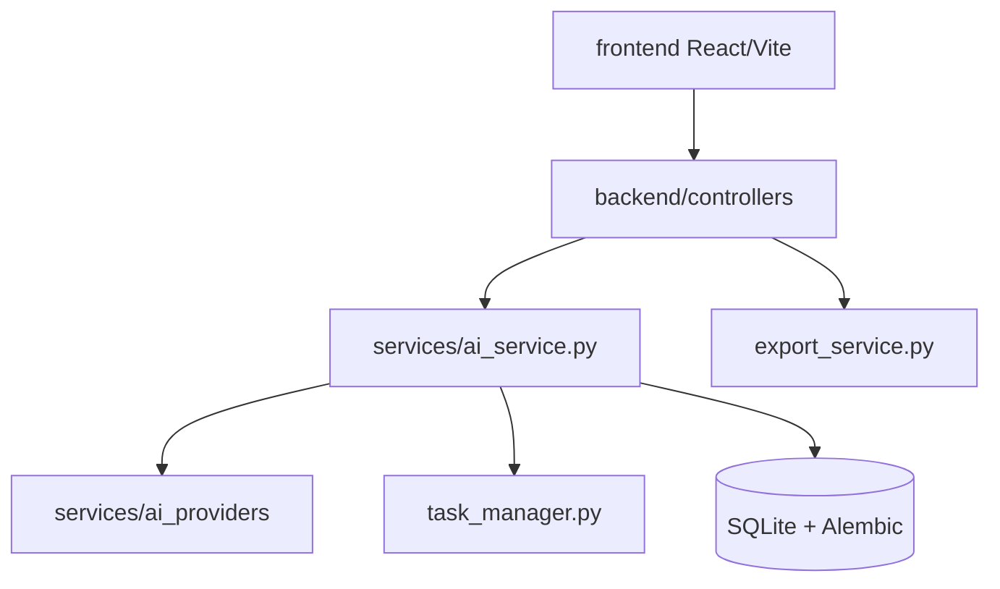

# Anionex/banana-slides

> Application that generates editable presentations from an idea or documents, using image models.

## The problem
PPT generators impose fixed templates, are hard to edit and give uniform results. Banana Slides aims for more freedom in style and editing.

## What it actually does
You start from an idea, an outline or page descriptions. The backend generates the content, imports PDF/Docx/MD, allows natural-language editing, then exports PPTX, PDF or video with narration. The editable PPTX export is in beta. Several model providers are supported.

## How it is wired


## Trying it
```bash
git clone https://github.com/Anionex/banana-slides
cd banana-slides
cp .env.example .env
docker compose -f docker-compose.prod.yml up -d
```

## Cost and gotchas
A model API key is required (Gemini, OpenAI, etc.); the README warns that the nano banana pro API is expensive. FFmpeg is required for video. Ports 3011 and 5011.

## What it is not
Not free for closed commercial use: the AGPL is supplemented by an authorization required for closed commercial use. The README is in Chinese.

## Alternatives
NotebookLM slide deck is compared in the README (15-page limit, watermark on the free tier).

## For you
Worth watching: interesting for a deliverables pipeline, but a restrictive license for professional use and variable API costs.
