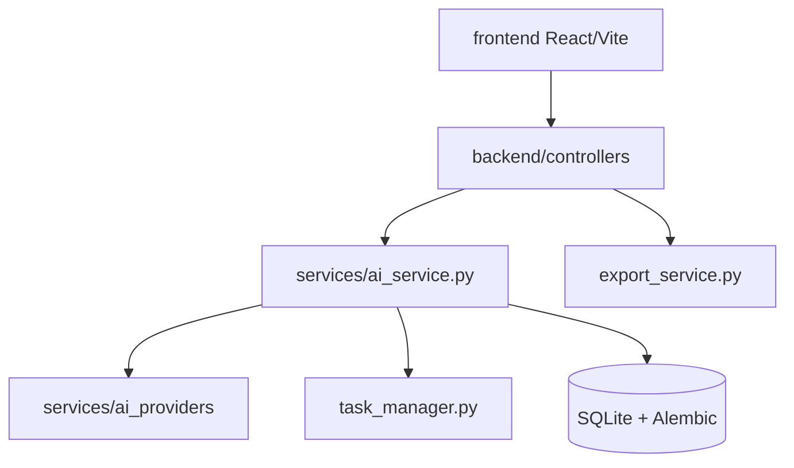

# Anionex/banana-slides

> Application qui génère des présentations éditables à partir d'une idée ou de documents, via modèles d'images.

## Le problème
Les générateurs de PPT imposent des modèles fixes, se modifient mal et donnent des résultats uniformes. Banana Slides vise plus de liberté de style et d'édition.

## Ce que ça fait vraiment
On part d'une idée, d'un plan ou de descriptions de pages. Le backend génère le contenu, importe PDF/Docx/MD, permet l'édition en langage naturel, puis exporte PPTX, PDF ou vidéo avec narration. L'export PPTX éditable est en bêta. Plusieurs fournisseurs de modèles sont pris en charge.

## Comment c'est branché


## Essayer
```bash
git clone https://github.com/Anionex/banana-slides
cd banana-slides
cp .env.example .env
docker compose -f docker-compose.prod.yml up -d
```

## Coût et pièges
Clé d'API de modèle nécessaire (Gemini, OpenAI, etc.) ; le README prévient que l'API nano banana pro coûte cher. FFmpeg requis pour la vidéo. Ports 3011 et 5011.

## Ce que ce n'est pas
Pas gratuit en usage commercial fermé : l'AGPL est complétée par une autorisation exigée pour un usage commercial fermé. Le README est en chinois.

## Alternatives
NotebookLM slide deck est comparé dans le README (limite de 15 pages, filigrane en gratuit).

## Pour toi
À surveiller : intéressant pour un pipeline de livrables, mais licence contraignante pour un usage pro et coûts d'API variables.

