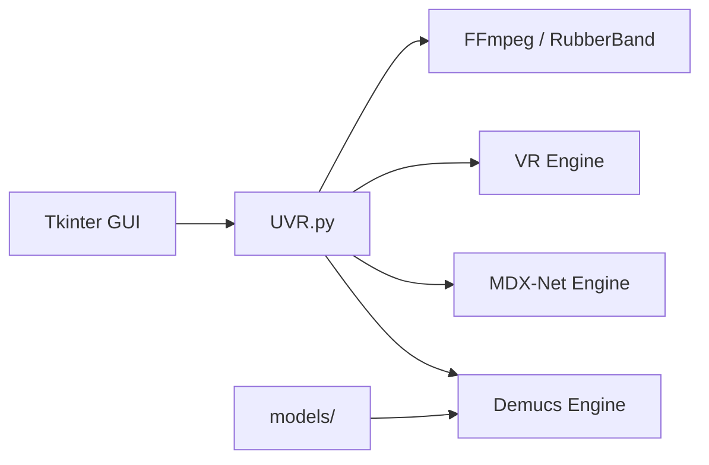

# Anjok07/ultimatevocalremovergui

> Desktop application to separate vocals and instruments in audio files, locally.

## The problem
Isolating a voice or an instrument from a track requires source-separation models and an audio chain that is hard to set up.

## What it actually does
Tkinter interface driving three families of engines: Demucs, MDX-Net and the VR architecture.
Models trained by the developers (except Demucs v3/v4 4 stems), stored in `models/`.
FFmpeg for non-WAV formats, Rubber Band for time-stretch and pitch.
Windows and macOS installers; manual Python installation on Linux.

## How it is wired


## Trying it
```bash
python3 -m venv venv
source venv/bin/activate
pip install -r requirements.txt
python UVR.py
```

## Cost and gotchas
Free; Nvidia GPU with 6 GB minimum, 8 GB recommended. On Windows, installing on C:\ is mandatory. Last push March 2025.

## What it is not
Not a library nor an API: interactive use through the GUI. Limited AMD support.

## Alternatives
No alternative named in the README (Demucs cited as the origin of one engine).

## For you
Ignore: consumer audio separation tool, outside data/MLOps needs and inactive for over a year.
