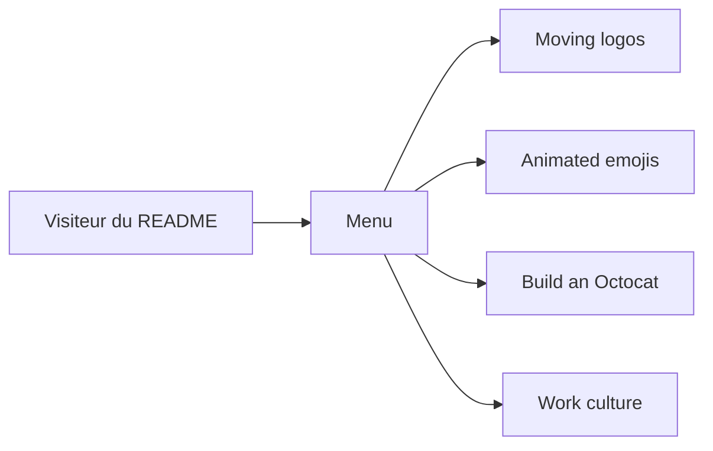

# Anmol-Baranwal/Cool-GIFs-For-GitHub

> Gallery of GIFs and visuals to embed in GitHub READMEs and profiles.

## The problem
Making a README or a GitHub profile livelier requires finding animated visuals.

## What it actually does
A Markdown gallery sorted by category: animated logos, social icons, animated emojis, "hello" banners, Octocat, avatars, "Work culture", stickers, banners. The repository only exposes `README.md` and `index.html`: no application code.

## How it is wired

## Trying it
No command: browse the README and copy the GIF links.

## Cost and gotchas
Free. Last push in September 2024. The rights to the reused GIFs are not specified.

## What it is not
Not a tool or a library: a collection of media.

## Alternatives
No alternative named in the README.

## For you
Ignore: profile decoration, with no technical value for data/AI/MLOps.
